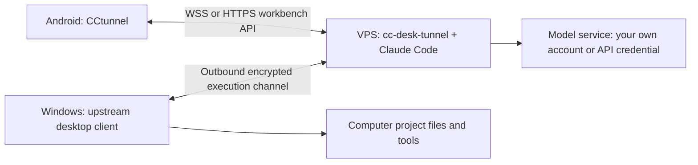
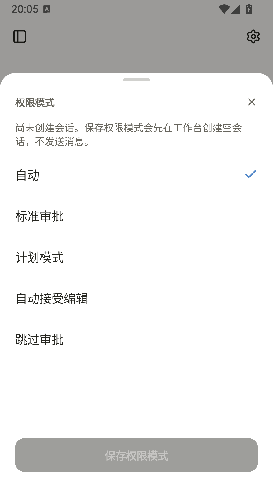

<!-- English overview. The default README is Simplified Chinese. -->

[简体中文](./README.md) | **English**

<p align="center">
  
</p>

<div align="center">

# CC Android Tunnel

<p>
  <strong>A native Android client for your CC workbench</strong><br />
  Connect to your workbench, follow conversations and tools, and manage sessions from Android.<br />
  <sub>Kotlin · Jetpack Compose · Workbench protocol 25</sub>
</p>

<p>
  <a href="#quick-start"></a>
  <a href="#verification"></a>
  <a href="https://github.com/sun168567/cc-desk-tunnel"></a>
  <a href="./LICENSE"></a>
</p>

<p>
  
  
  
  
  
  
</p>

> Connect to and operate your workbench on Android with Kotlin and Jetpack Compose.

</div>

First, a big thank-you to [sun168567](https://github.com/sun168567) and everyone contributing to [cc-desk-tunnel](https://github.com/sun168567/cc-desk-tunnel) for building something so useful and sharing it as open source. This Android version builds on their work, with a simple aim: let you pick up your phone and keep going when you're away from your computer. If you find it useful, consider giving the upstream project a star and showing its creators some support!

## Overview

The launcher and in-app display name is **CCtunnel**; the project name is **CC Android Tunnel**.

**Use this app to operate your own CC Desk Tunnel workbench from an Android phone.** Start a project session on your computer, then use your phone to send requests, follow streamed replies and tool output, respond to supported approvals, or stop and resume work. You can also create ordinary sessions that execute on the server.

**CC Android Tunnel is an independently maintained, unofficial native port based on [sun168567/cc-desk-tunnel](https://github.com/sun168567/cc-desk-tunnel).** It is not an official upstream Android release; no upstream endorsement is implied.

### How the three parts work together

| Component | Installed on | Responsibility |
| --- | --- | --- |
| Upstream cc-desk-tunnel server | Your Linux VPS | Runs Claude Code, stores sessions and model credentials, and connects your devices |
| Upstream CC Desk Tunnel desktop client | Your project computer | Selects local projects and establishes the execution channel for commands and file access on that computer |
| This CCtunnel Android app | Your Android phone | Controls sessions through the same server; it does not run the computer's development tools on the phone |



To work on a **computer project**, create its session in the desktop client and open that existing session on the phone. The computer must remain powered on, online and connected through the desktop client. The phone can use a different network. An ordinary session **created directly on the phone runs in the server container**; it does not automatically use the computer's project or upload phone files.

Upstream supplies the server and desktop execution channel; this repository supplies the native Android interface. VPS hosting and model usage are separate costs. See the [upstream architecture](https://github.com/sun168567/cc-desk-tunnel/blob/v0.3.14/docs/architecture.md).

This repository contains a standalone Android project. Its UI, networking, Markdown and code rendering run natively, without React Native, Expo, Hermes, Metro, a JavaScript business runtime or a WebView-hosted interface. Building and running the client does not require Node.js.

See [verification](#verification) for the checked scope, test commands and scenarios awaiting validation.

You need an accessible **protocol 25 workbench service** and its authentication details. This repository supplies the Android client, not the workbench server or model service. The app currently uses a Chinese interface.

## App Screenshots

These captures show the current native app on an Android emulator: the light and dark home screens, permission picker and session settings. They contain no conversation messages or connection credentials. Static screenshots illustrate the layout; see [verification](#verification) for the scope of animation, real-service and device checks.

<table>
  <tr>
    <th>Light home screen</th>
    <th>Dark home screen</th>
  </tr>
  <tr>
    <td><a href="./docs/screenshots/home-light.png"></a></td>
    <td><a href="./docs/screenshots/home-dark.png"></a></td>
  </tr>
  <tr>
    <th>Permission picker</th>
    <th>Session settings</th>
  </tr>
  <tr>
    <td><a href="./docs/screenshots/permission-picker.png"></a></td>
    <td><a href="./docs/screenshots/session-settings.png"></a></td>
  </tr>
</table>

## Capabilities

The table describes the native implementation. Server capabilities and permissions still determine which operations are available; implementation scope is distinct from acceptance evidence.

| Area | Native implementation |
| --- | --- |
| Connection and authentication | HTTPS workbench login, direct WSS service-token connection, connection status, logout and reconnection |
| Sessions and projects | Session list, creation, switching, renaming, deletion and pinning; projects shown in the session list, content search and earlier-history loading |
| Conversation | Send messages, receive streaming replies, stop generation, continue a run and request context compaction |
| Content rendering | Native Markdown, syntax-highlighted code, tables, links, images, text selection and copying |
| Tools and interaction | Thinking content, tool calls and results, permission replies, question answers, background-task controls |
| Model controls | Server-provided model catalog, custom model identifiers, thinking effort and session configuration |
| Composer and session settings | Permission mode on the left of the composer, model selection and send on the right; the top-right gear opens search, status refresh, context and background-task controls |
| Settings | Connection and access management, TOTP controls, account and usage views, in-app notifications and help |
| Android behavior | Light/dark themes, native multiline editor, keyboard avoidance, scrolling, gestures, disabled and read-only states |
| Recovery and local state | Retain loaded history during temporary disconnection, recover by durable event cursor, persist service-scoped preferences and protect credentials with Android Keystore |

## Quick Start

This walkthrough uses an **Ubuntu 24.04 LTS x86_64 VPS, Windows 10/11 x64 computer and Android 7.0+ phone**. Already have a working server and connected desktop? Start with step 6. A more detailed [Chinese walkthrough](./README.md#快速开始) includes per-step success checks.

**Compatibility checked November 14, 2026:** the example pins the upstream server and desktop to [v0.3.14](https://github.com/sun168567/cc-desk-tunnel/releases/tag/v0.3.14), which uses protocol **25**. This app's `1.0.x-native` version is independent. Keep upstream desktop/server versions aligned, and check protocol compatibility before upgrading; a future latest release is not automatically compatible.

### 1. Get a VPS and prepare your devices

In your computer's browser, compare Linux VPS plans from these official sites:

| Provider | Official site | Product |
| --- | --- | --- |
| RackNerd | [racknerd.com](https://www.racknerd.com/) | Linux KVM VPS |
| Vultr | [vultr.com](https://www.vultr.com/) | Cloud Compute; [official provisioning guide](https://docs.vultr.com/products/compute/instances/cloud-compute/provisioning) |
| DigitalOcean | [digitalocean.com](https://www.digitalocean.com/products/droplets) | Linux Droplet |
| Hetzner | [hetzner.com](https://www.hetzner.com/cloud/) | Cloud Server |

Choose Ubuntu 24.04 LTS, x86_64/amd64 and a public IPv4 address. This tutorial suggests starting with **2 vCPU, 2 GB RAM and 25 GB SSD** for operating headroom; this is a recommendation, not an upstream minimum. Computer-side builds do not require a GPU on the VPS. Server-side builds may need more resources. Check current prices, renewals, transfer allowances, IPv4 charges and refund terms before paying. These links have no referral parameters.

The VPS must reach GitHub, GHCR and your model provider, and your computer/phone must reach the VPS. Both your eligibility and deployment must comply with the provider's [supported-regions policy](https://www.anthropic.com/legal/supported-regions) and [terms](https://code.claude.com/docs/en/legal-and-compliance); buying a VPS alone does not grant eligibility or model access. Save its IP, SSH port, username and SSH key/password. Have your own model account or API credentials ready. A domain is optional for the direct-IP path below.

### 2. Connect to the VPS and install Docker

From Windows PowerShell:

```powershell
ssh root@YOUR_VPS_IP
```

Use your provider's actual username, such as `ubuntu`, and `ssh -p PORT USER@IP` for a nonstandard SSH port. Verify the SSH host identity. After connecting, run Linux commands on the VPS:

```bash
cat /etc/os-release
uname -m
sudo apt update
sudo apt install -y ca-certificates curl
```

For a fresh VPS, follow [Docker's official Ubuntu apt installation steps](https://docs.docker.com/engine/install/ubuntu/#install-using-the-apt-repository): configure the repository, install Engine and the Compose plugin, then verify. An existing Docker host should be inspected before changing its installation.

```bash
sudo docker version
sudo docker compose version
sudo docker run --rm hello-world
```

Continue when the daemon and Compose report versions and the test container exits successfully. The upstream installer checks dependencies but does not install Docker for you.

### 3. Deploy the upstream server

On the VPS, use the [upstream deployment manual](https://github.com/sun168567/cc-desk-tunnel/blob/v0.3.14/deploy/README.md) and the pinned official installer:

```bash
curl -fL https://raw.githubusercontent.com/sun168567/cc-desk-tunnel/v0.3.14/deploy/install.sh -o cc-desk-install.sh
less cc-desk-install.sh
sudo env CC_DESK_TUNNEL_VERSION=0.3.14 bash cc-desk-install.sh
```

Press `q` to leave `less` before running the last command. These are new-deployment instructions; do not downgrade an existing installation just to match the example.

In the wizard, confirm your public IP, select self-signed TLS for this direct-IP example, retain port **8787** and the default data directory **`/srv/cc-desk-tunnel`**, and leave the credential input empty to generate a random secret. Existing domain/CA/nginx deployments should follow their corresponding upstream instructions. The program normally installs under `/opt/cc-desk-tunnel`.

Save the final **WSS address**, **SHA-256 leaf-certificate fingerprint** and **service credential**. Example address: `wss://203.0.113.10:8787/ws`; replace the documentation IP with yours. Obtain the fingerprint from your own trusted SSH session.

Allow **8787/TCP** through the provider's security group and check the host firewall. Retain the SSH port used for administration. Do not open every port, the obsolete port 7000, or inbound Windows ports. Docker-published ports may bypass UFW; see [upstream security boundaries](https://github.com/sun168567/cc-desk-tunnel/blob/v0.3.14/docs/deployment.md). In nginx mode expose 443 instead and retain a loopback-only backend.

```bash
sudo cc-desk-tunnel status
sudo cc-desk-tunnel summary
```

Continue when the service is running and you have all three connection values. `summary` includes secrets: do not publish its output. The service credential controls this workbench and can authorize operations on connected computers.

### 4. Connect the Windows desktop client

On your project computer:

1. Download `CC-Desk-Tunnel-Setup-0.3.14-x64.exe` and `SHA256SUMS` from the [upstream v0.3.14 release](https://github.com/sun168567/cc-desk-tunnel/releases/tag/v0.3.14).
2. Compare `Get-FileHash .\CC-Desk-Tunnel-Setup-0.3.14-x64.exe -Algorithm SHA256` with that release's checksum list, then install. The Windows installer includes PowerShell 7 and OpenSSH; see the [upstream desktop guide](https://github.com/sun168567/cc-desk-tunnel/tree/v0.3.14#图形客户端).
3. Enter the server's WSS address, verified certificate fingerprint and service credential. For a publicly trusted CA certificate, normally leave the fingerprint empty.
4. Wait until the workbench is connected and the computer's execution channel is ready. Windows connects outbound; router port forwarding is unnecessary.

### 5. Configure model access and create a computer session

Use the desktop account page to complete your own supported official Claude login, following [upstream's account instructions](https://github.com/sun168567/cc-desk-tunnel/tree/v0.3.14#3-登录-claude). The account needs permission and available quota; credentials are stored on the server.

Alternatively, for API-based access, configure the provider-supported environment settings in `<DATA_DIRECTORY>/config/provider.json` on the VPS, following [upstream model configuration](https://github.com/sun168567/cc-desk-tunnel/blob/v0.3.14/deploy/README.md#模型与可写空间). The default is `/srv/cc-desk-tunnel/config/provider.json`. Preserve valid JSON, run `sudo cc-desk-tunnel restart` on the VPS, and verify model/account status in the desktop client. Do not enter a model API key in the phone's service-credential field.

In the desktop client, add a test project such as `D:\Projects\hello-tunnel`, create a session named `Mobile check`, and ask: `List the files in the current project root and report the working directory. Do not modify files.` Verify that the directory and files belong to this Windows computer.

Keep the three credentials separate: **SSH key/password** manages the VPS; **service credential** connects clients to cc-desk-tunnel; **model account/API key** lets the server call the model provider.

### 6. Install CCtunnel on Android

Check [this project's Releases](https://github.com/tuolola/cc-android-tunnel/releases) for a published APK. If the desired version has none, use [Build the Android App](#build-the-android-app) below to produce `CCtunnel.apk`. Upstream Windows/macOS/Linux downloads are not phone packages.

Transfer an APK from this project's release or your own build to the phone and install it. With USB debugging enabled, you can alternatively run `adb install -r .\artifacts\CCtunnel.apk` on the development computer. Open **CCtunnel** and its connection screen. The phone does not need Node, Docker or Android Studio.

### 7. Connect the phone to the same server

The main path uses direct WSS and does **not** require upstream Web access to be enabled. In **连接工作台**, select **使用服务地址直连** if currently in HTTPS mode:

| App field | Value |
| --- | --- |
| 服务地址 | Full `wss://YOUR_VPS_IP:8787/ws`, or the domain address given by your nginx deployment. Do not use phone localhost, a Windows LAN IP or an SSH address |
| 服务证书指纹（可选） | Trusted SHA-256 leaf fingerprint for self-signed TLS; normally empty for a system-trusted CA. This is not the SSH host fingerprint |
| 服务凭据 | The complete random workbench credential, not a VPS password, Claude password or model API key |

Tap **连接**, open the session list and choose the existing `Mobile check` session. Confirm its desktop history appears. To work on that computer project, use this session: creating a new ordinary session on the phone instead targets the Linux server container.

Direct WSS authenticates using the service credential. HTTPS uses Web login, cookies and optional TOTP; enabling Web TOTP does not add a TOTP challenge to the direct WSS endpoint.

### 8. Continue a computer task from the phone

1. Keep the VPS and desktop client connected, and keep the project computer awake. The desktop client may remain in the tray.
2. On the phone, open `Mobile check` and send: `Create mobile-check.txt in this test project containing Hello from Android. If it exists, tell me first; do not overwrite it.`
3. Watch the streamed response and tool activity. Read any approval before responding. Not all real approval flows have completed acceptance testing; use the desktop if a request cannot be handled on the phone.
4. Check the file and its contents on the computer. This verifies the phone → VPS → desktop execution path.
5. Reopen the same session to continue later. Use stop/resume as available. After a network interruption, inspect existing results before repeating a request that changes files.

A server-only session does not need the Windows computer online, but the server container must have that task's files and tools.

### Optional: HTTPS workbench login

Follow the [upstream Web-access guide](https://github.com/sun168567/cc-desk-tunnel/blob/v0.3.14/docs/server-web.md): enable **设置 → 浏览器访问** in the desktop client and copy its complete HTTPS address, including any custom path. In the phone's connection screen choose **浏览器访问**, enter that address in **HTTPS 入口地址**, configure certificate trust, and connect. Enter the workbench service credential as **工作台密码**, plus the current six-digit code if TOTP is enabled. Do not append `/ws` or manually construct `/api/ws`.

Use the new full URL after a domain/path change. For domains and reverse proxies see [upstream nginx setup](https://github.com/sun168567/cc-desk-tunnel/blob/v0.3.14/deploy/nginx.md). “Browser access” names the upstream authentication interface; the Android UI remains native Compose, without WebView rendering.

### Troubleshooting and maintenance

| Symptom | Check |
| --- | --- |
| Timeout | VPS status, public address/port, provider and host firewalls, and phone-to-VPS connectivity |
| Certificate failure | Correct fingerprint for the actual endpoint, certificate rotation/expiry and phone time; do not disable TLS verification |
| Credential rejection | Complete workbench credential, not SSH/model credentials; update all clients after rotation |
| HTTPS 404 or missing login information | Web access enabled, exact domain and configured path; direct WSS uses root `/ws` |
| History loads but computer commands fail | Computer awake and online, desktop execution channel ready, correct session ownership |
| New phone session cannot find a Windows path | It is a server session; create the project session on the desktop and open it on the phone |
| Connected but model requests fail | Model login, quota, provider configuration and outbound server connectivity |
| Version mismatch | App protocol 25 compatibility; do not upgrade or downgrade blindly |

On the VPS use `sudo cc-desk-tunnel status`, `sudo cc-desk-tunnel logs` and `sudo cc-desk-tunnel summary`. Before upgrades or certificate changes, stop active work, back up and follow [upstream maintenance](https://github.com/sun168567/cc-desk-tunnel/blob/v0.3.14/deploy/README.md#运维). Backups contain secrets and history. Android APK updates are independent of upstream desktop/server updates.

## Build the Android App

These commands run on a development computer to obtain an APK; they do not deploy the VPS server.

### 1. Prepare the environment

- JDK **17 or 21**, with `JAVA_HOME` configured.
- Android SDK **platform 36**, Android SDK Build Tools, and Platform Tools for installation.
- An Android **7.0 / API 24** or newer device or emulator.
- Network access for the first Gradle and dependency download. The **Gradle 8.13** wrapper is included.

```bash
git clone --branch native/android-compose https://github.com/tuolola/cc-android-tunnel.git
cd cc-android-tunnel
```

Open the repository root in an Android Studio version compatible with Android Gradle Plugin 8.13.1, or build from the command line.

### 2. Build and install

On Windows, set `ANDROID_HOME` to your SDK directory, then run:

```powershell
.\scripts\build-native.ps1
adb install -r .\artifacts\CCtunnel.apk
```

The helper builds the debug APK, runs JVM tests and Android Lint, copies the APK to **`artifacts/CCtunnel.apk`**, and prints its SHA-256. It accepts `-AndroidSdk <path>` and `-GradleCache <path>`; `-SkipTests` omits JVM tests and Lint.

Alternatively, configure `sdk.dir` in the untracked `local.properties` and run Gradle directly:

```powershell
.\gradlew.bat :app:assembleDebug :app:testDebugUnitTest :app:lintDebug
```

On macOS/Linux, use `./gradlew` instead. Direct Gradle output is **`app/build/outputs/apk/debug/app-debug.apk`**. `:app:assembleRelease` produces an unsigned release APK; configure your own signing before distributing it.

After installation, return to step 7 above. No service URL, password or token is bundled with the app.

## Verification

### Run the checks

```powershell
.\gradlew.bat :app:testDebugUnitTest :app:lintDebug
.\gradlew.bat :app:connectedDebugAndroidTest
python -B -m unittest discover -s scripts -p "test_*.py"
python -B scripts/audit-native-apk.py app/build/outputs/apk/debug/app-debug.apk --project . --dependencies app/build/reports/native-boundary/native-dependencies.txt
```

Device tests require a connected emulator or device. Build the APK as described above before running the independent audit. Python is only needed for the optional independent APK audit and its regression tests, not for the app or Gradle build.

Use `scripts/measure-performance.ps1` with the [performance testing guide (Chinese)](./docs/performance-testing.md) to sample startup time or Android frame statistics during a specified interaction window. Reports go to the ignored `artifacts/performance/` directory. Diagnostic samples do not establish release-build performance acceptance.

[The native build guard](./gradle/native-boundary.gradle.kts) checks production sources and resolved runtime dependencies. APK assembly also checks DEX references, packaged assets and native libraries for excluded JavaScript engines and WebView rendering. [The Python audit](./scripts/audit-native-apk.py) provides a separate check. The guard permits AndroidX's static `WebView.findAddress` compatibility reference; constructing or rendering a WebView remains rejected.

### Current verification results — 2026-11-14

| Check | Result for this run |
| --- | --- |
| Build | Debug APK and Android instrumentation APK built successfully |
| JVM tests | 43 passed, 0 failed |
| Independent audit regression tests | 8 passed |
| Android Lint | 0 errors, 37 warnings |
| Native enforcement | APK native-boundary check and independent APK audit passed |
| Full Android device suite | 61 total: 58 passed, 3 real-service opt-in tests skipped, 0 failed |

The device suite includes 13 session-settings tests covering saved and cancelled permission changes, draft-session creation, read-only and running states, the narrow-screen composer and repeated stop requests. Full real-service flows were not rerun in this round; the three opt-in skips do not establish acceptance of real connections, tool execution or network-loss recovery. These results apply to this build and the tested emulator, not every device.

### Test sources and acceptance boundaries

| Tests | Purpose |
| --- | --- |
| [Protocol](./app/src/test/java/dev/ccdesk/nativeapp/core/ProtocolTest.kt) · [Security](./app/src/test/java/dev/ccdesk/nativeapp/core/SecurityTest.kt) | Fragment merging, history cursors, continuation, reconnect isolation, authentication and TLS rules |
| [Native TLS integration](./app/src/androidTest/java/dev/ccdesk/nativeapp/core/NativeTlsIntegrationTest.kt) · [Credential vault](./app/src/androidTest/java/dev/ccdesk/nativeapp/core/CredentialVaultTest.kt) · [Silent peer recovery](./app/src/androidTest/java/dev/ccdesk/nativeapp/core/SilentPeerRecoveryTest.kt) | Local TLS fixtures, encrypted credentials and missing-Pong recovery on Android |
| [UI instrumentation](./app/src/androidTest/java/dev/ccdesk/nativeapp/ui) | Native composer, Markdown, approval/question fixtures, models, settings, gestures and all seven offline license documents |
| [Session settings](./app/src/androidTest/java/dev/ccdesk/nativeapp/ui/SessionSettingsTest.kt) | Permission modes, saving and cancelling, session actions, state restrictions and the narrow-screen composer |
| [Real chat](./app/src/androidTest/java/dev/ccdesk/nativeapp/core/LiveWorkbenchAcceptanceTest.kt) · [Real tool](./app/src/androidTest/java/dev/ccdesk/nativeapp/core/RealToolAcceptanceTest.kt) · [Real network](./app/src/androidTest/java/dev/ccdesk/nativeapp/core/RealNetworkRecoveryTest.kt) | Explicit opt-in tests requiring service access or network interruption; default skips are not acceptance passes |

Read the argument checks before enabling opt-in tests. Real-service tests require an explicitly matched host and an existing login; the network test temporarily disables Wi-Fi and requires a designated test session. Use a test device and service.

**Remaining acceptance work:**

- A real permission-approval/question round trip; current approval/question coverage uses native UI fixtures.
- Real background tasks, complete TOTP/access-revocation flows and exhaustive multi-window history pagination.
- Animation smoothness, rapid repeated actions and interrupted transitions on real devices; controlled-clock gesture tests do not replace these checks.
- Physical-device haptics, TalkBack, additional Android API levels and large font scales.
- Complete visual checks across system fonts, text-selection handles and screen sizes.

## Security and Local Data

HTTPS/WSS are required. System CA mode retains platform trust and hostname checks. Explicit fingerprint mode checks the configured host, the exact leaf certificate fingerprint and certificate validity; there is no trust-all fallback. Authentication redirects are disabled.

Saved tokens and browser-session cookies are encrypted using Android Keystore. Logout and trust changes clear the applicable credentials. App backup is disabled. Service-scoped local preferences are separate from credentials; retained history during a disconnect is not an offline archive of all server conversations.

The Android installation ID is `dev.ccdesk.nativeapp`. Connection deep links use `cc-android-tunnel://`.

## Project Structure

| Path | Responsibility |
| --- | --- |
| `app/src/main/java/dev/ccdesk/nativeapp/core` | Protocol, coroutine state, transport, certificate trust and encrypted credentials |
| `app/src/main/java/dev/ccdesk/nativeapp/ui` | Compose screens, native editor, transcript projection, Markdown, icons and gestures |
| `app/src/main/res` | App resources, original icon assets and third-party license notices |
| `app/src/test` | JVM protocol, security, transcript and code-highlighting tests |
| `app/src/androidTest` | Android integration, UI and opt-in real-service acceptance tests |
| `gradle/native-boundary.gradle.kts` | Source, dependency and packaged-APK enforcement |
| `scripts` | Windows build helper, independent APK audit and performance diagnostics |

## Origin and License

This project is based on **[sun168567/cc-desk-tunnel](https://github.com/sun168567/cc-desk-tunnel)** and is independently maintained at **[tuolola/cc-android-tunnel](https://github.com/tuolola/cc-android-tunnel)** as an unofficial native Android port. Upstream work and attribution are retained; this repository has its own native implementation and maintenance lifecycle.

Project code and documentation are distributed under the **[Apache License 2.0](./LICENSE)**. See **[NOTICE](./NOTICE)** for provenance and attribution. Third-party dependencies, icons and adapted code retain their respective licenses, including the [bundled third-party notices](./app/src/main/res/raw/third_party_notices.txt) and individual notices in [app/src/main/res/raw](./app/src/main/res/raw). Preserve those notices when redistributing the source or app.

The project license, attribution and third-party notices are also available offline in the app under **Help → Open-source licenses and acknowledgements** (`帮助 → 开源许可与致谢`).
