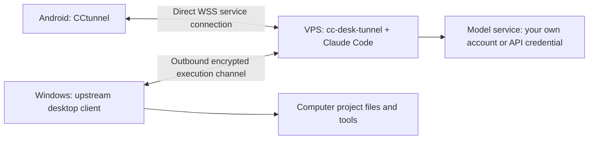
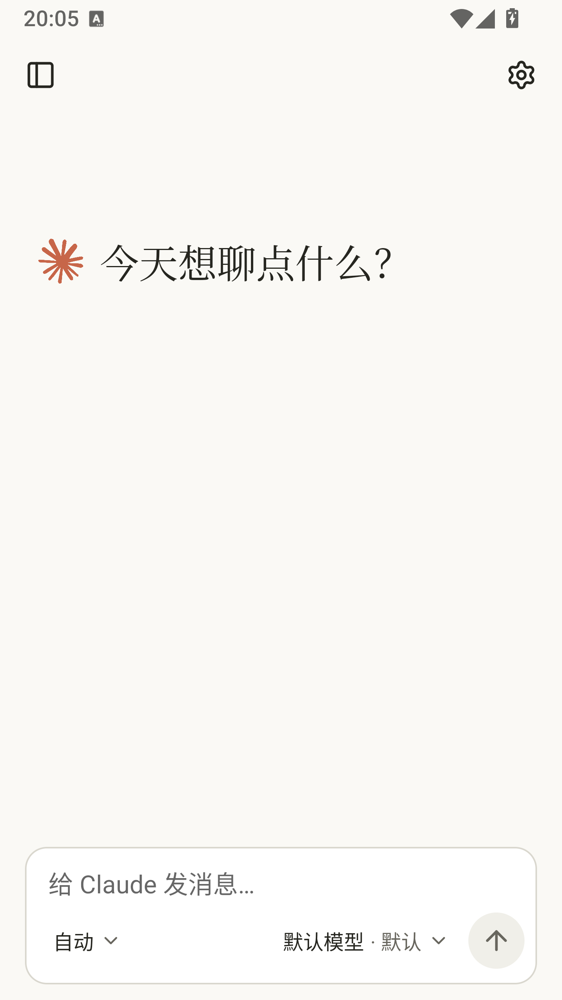
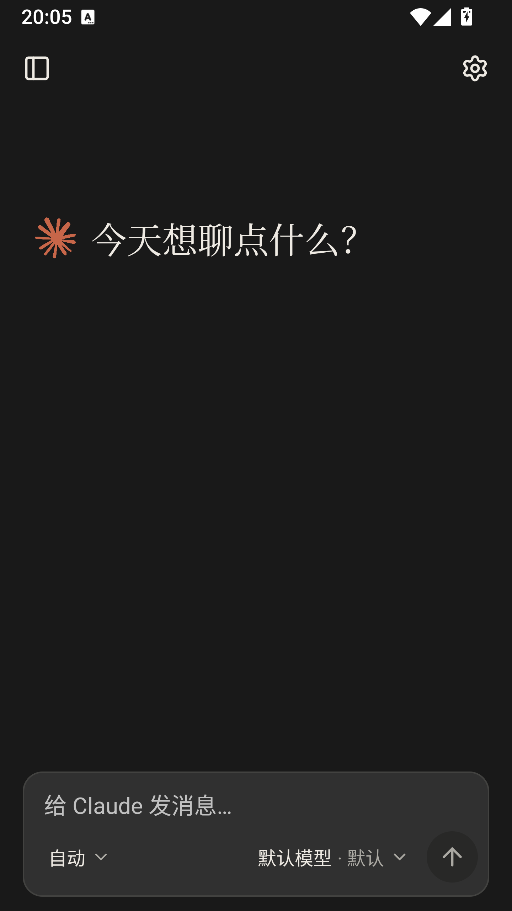
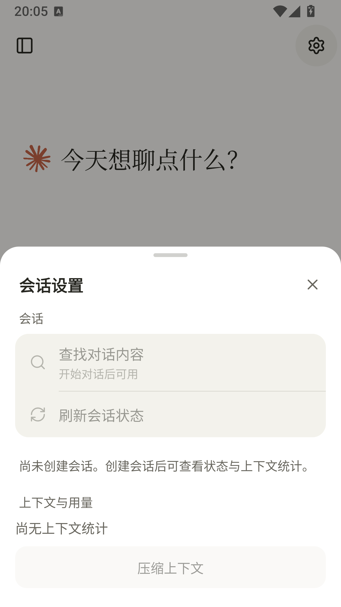

<!-- English overview. The default README is Simplified Chinese. -->

[简体中文](./README.md) | **English**

<p align="center">
  
</p>

<div align="center">

# CC Android Tunnel

<p>
  <strong>A native Android client for your CC workbench</strong><br />
  Connect to your workbench, follow conversations and tools, and manage sessions from Android.<br />
  <sub>Kotlin · Jetpack Compose · Workbench source protocol 29</sub>
</p>

<p>
  <a href="https://github.com/tuolola/cc-android-tunnel/releases/download/v1.0.6-native/CCtunnel.apk"></a>
  <a href="#quick-start"></a>
  <a href="#verification"></a>
  <a href="https://github.com/sun168567/cc-desk-tunnel"></a>
  <a href="./LICENSE"></a>
</p>

<p>
  
  
  
  
  
  
</p>

> Connect to and operate your workbench on Android with Kotlin and Jetpack Compose.

</div>

**Compatibility:** the current source build, **1.0.7-native** (versionCode 13), uses **protocol 29** with upstream **v0.3.19** or **v0.3.18**. The linked public APK, **v1.0.6-native**, uses **protocol 26** with upstream **v0.3.15**. See the [protocol 29 notes (Chinese)](./docs/protocol-29.md).

**Public 1.0.4-native compatibility note (versionCode 10):** This version supports only direct WSS service connections. HTTPS workbench login and the connection-mode switch have been removed. Old HTTPS addresses are not converted automatically: enter the complete WSS service address and credential supplied by your administrator. Existing WSS connections retain the credentials and certificate fingerprints saved for their addresses.

First, a big thank-you to [sun168567](https://github.com/sun168567) and everyone contributing to [cc-desk-tunnel](https://github.com/sun168567/cc-desk-tunnel) for building something so useful and sharing it as open source. This Android version builds on their work, with a simple aim: let you pick up your phone and keep going when you're away from your computer. If you find it useful, consider giving the upstream project a star and showing its creators some support!

## Overview

The launcher and in-app display name is **CCtunnel**; the project name is **CC Android Tunnel**.

**Use this app to operate your own CC Desk Tunnel workbench from an Android phone.** Open an existing conversation or start one in an online computer's project from Remote Control. Follow streamed replies and tool output, respond to approvals, and stop or resume work. Ordinary sessions created from the sidebar run on the server.

**CC Android Tunnel is an independently maintained, unofficial native port based on [sun168567/cc-desk-tunnel](https://github.com/sun168567/cc-desk-tunnel).** It is not an official upstream Android release; no upstream endorsement is implied.

### How the three parts work together

| Component | Installed on | Responsibility |
| --- | --- | --- |
| Upstream cc-desk-tunnel server | Your Linux VPS | Runs Claude Code, stores sessions and model credentials, and connects your devices |
| Upstream CC Desk Tunnel desktop client | Your project computer | Selects local projects and establishes the execution channel for commands and file access on that computer |
| This CCtunnel Android app | Your Android phone | Controls sessions through the same server; it does not run the computer's development tools on the phone |



To work on a **computer project**, create its session in the desktop client, then open it under the corresponding computer in the phone sidebar's **远程控制** (Remote control) page. The computer must remain powered on, online and connected through the desktop client. The phone can use a different network. An ordinary session **created directly on the phone runs in the server container**; it does not automatically use the computer's project or upload phone files.

Upstream supplies the server and desktop execution channel; this repository supplies the native Android interface. VPS hosting and model usage are separate costs. See the [upstream architecture](https://github.com/sun168567/cc-desk-tunnel/blob/v0.3.19/docs/architecture.md).

This repository contains a standalone Android project. Its UI, networking, Markdown and code rendering run natively, without React Native, Expo, Hermes, Metro, a JavaScript business runtime or a WebView-hosted interface. Building and running the client does not require Node.js.

See [verification](#verification) for the checked scope, test commands and scenarios awaiting validation.

Use an accessible workbench server and its service credential. The current source build targets protocol 29. The app currently uses a Chinese interface.

## Historical App Screenshots

These captures preserve the **layout before the 1.0.4 redesign**: the old light and dark home screens, permission picker and session settings. They contain no conversation messages or connection credentials. The current top bar, sidebar, composer and menus have changed; see the [UI reference and verification notes (Chinese)](./docs/ui-reference.md) for this redesign and [verification](#verification) for the checked scope.

<table>
  <tr>
    <th>Light home screen</th>
    <th>Dark home screen</th>
  </tr>
  <tr>
    <td><a href="./docs/screenshots/home-light.png"></a></td>
    <td><a href="./docs/screenshots/home-dark.png"></a></td>
  </tr>
  <tr>
    <th>Permission picker</th>
    <th>Session settings</th>
  </tr>
  <tr>
    <td><a href="./docs/screenshots/permission-picker.png"></a></td>
    <td><a href="./docs/screenshots/session-settings.png"></a></td>
  </tr>
</table>

## Capabilities

The table describes the native implementation. Server capabilities and permissions still determine which operations are available; implementation scope is distinct from acceptance evidence.

| Area | Native implementation |
| --- | --- |
| Connection and authentication | WSS service-credential authentication, certificate fingerprints, connection status, logout and reconnection |
| Sidebar and sessions | Remote control, notifications and ordinary conversation history; local title search, 30 more cached rows per expansion, session creation/switching, message search and earlier-history loading |
| Remote control | Project sessions grouped by computer, computer/session search and retained offline history; excludes the server and this phone by device identity |
| Conversation | Send messages, receive streaming replies, stop generation and continue runs when their state permits |
| Content rendering | Native Markdown, syntax-highlighted code, tables, links and images; reply copying, text selection and system sharing, plus individual code-block copying |
| Tools and interaction | Thinking content, tool calls and results, permission replies and question answers; supported active tools can move to the background or stop |
| Model controls | Model picker in the top bar; server catalogs prefetched per device after connection, custom model identifiers and server-supported thinking effort |
| Composer and session menu | Permission entry on the left of the composer only for computer sessions; new chat in the top bar, with only find and refresh in the top-right session menu |
| Settings | Open settings from the sidebar's bottom avatar; settings search, direct-connection settings, server Web-access management and TOTP controls, account/usage, notifications and help |
| Android behavior | Light/dark themes, native multiline editor, keyboard avoidance, scrolling, gestures, disabled and read-only states |
| Recovery and local state | Retain loaded history during temporary disconnection, recover by durable event cursor, persist service-scoped preferences and protect credentials with Android Keystore |

**App updates (starting with `1.0.2-native`)**: open settings from the sidebar's bottom avatar for manual checks, automatic foreground checks and a prerelease toggle. Automatic checks wait 24 hours after success or one hour after failure. Downloads open in the system browser for user installation. Older `v1.0.1-native` installations do not include this feature; download and install the compatible APK manually first. See [App updates and release maintenance (Chinese)](./docs/app-updates.md).

## Quick Start

This walkthrough uses an **Ubuntu 24.04 LTS x86_64 VPS, Windows 10/11 x64 computer and Android 7.0+ phone**. Already have a working server and connected desktop? Start with step 6. A more detailed [Chinese walkthrough](./README.md#快速开始) includes per-step success checks.

**Tutorial baseline:** upstream [v0.3.19](https://github.com/sun168567/cc-desk-tunnel/releases/tag/v0.3.19) and the **1.0.7-native source build**, using **protocol 29**. Follow the upstream release instructions when upgrading an existing deployment.

### 1. Get a VPS and prepare your devices

In your computer's browser, compare Linux VPS plans from these official sites:

| Provider | Official site | Product |
| --- | --- | --- |
| RackNerd | [racknerd.com](https://www.racknerd.com/) | Linux KVM VPS |
| Vultr | [vultr.com](https://www.vultr.com/) | Cloud Compute; [official provisioning guide](https://docs.vultr.com/products/compute/instances/cloud-compute/provisioning) |
| DigitalOcean | [digitalocean.com](https://www.digitalocean.com/products/droplets) | Linux Droplet |
| Hetzner | [hetzner.com](https://www.hetzner.com/cloud/) | Cloud Server |

Choose Ubuntu 24.04 LTS, x86_64/amd64 and a public IPv4 address. This tutorial suggests starting with **2 vCPU, 2 GB RAM and 25 GB SSD** for operating headroom; this is a recommendation, not an upstream minimum. Computer-side builds do not require a GPU on the VPS. Server-side builds may need more resources. Check current prices, renewals, transfer allowances, IPv4 charges and refund terms before paying. These links have no referral parameters.

The VPS must reach GitHub, GHCR and your model provider, and your computer/phone must reach the VPS. Both your eligibility and deployment must comply with the provider's [supported-regions policy](https://www.anthropic.com/legal/supported-regions) and [terms](https://code.claude.com/docs/en/legal-and-compliance); buying a VPS alone does not grant eligibility or model access. Save its IP, SSH port, username and SSH key/password. Have your own model account or API credentials ready. A domain is optional for the direct-IP path below.

### 2. Connect to the VPS and install Docker

From Windows PowerShell:

```powershell
ssh root@YOUR_VPS_IP
```

Use your provider's actual username, such as `ubuntu`, and `ssh -p PORT USER@IP` for a nonstandard SSH port. Verify the SSH host identity. After connecting, run Linux commands on the VPS:

```bash
cat /etc/os-release
uname -m
sudo apt update
sudo apt install -y ca-certificates curl
```

For a fresh VPS, follow [Docker's official Ubuntu apt installation steps](https://docs.docker.com/engine/install/ubuntu/#install-using-the-apt-repository): configure the repository, install Engine and the Compose plugin, then verify. An existing Docker host should be inspected before changing its installation.

```bash
sudo docker version
sudo docker compose version
sudo docker run --rm hello-world
```

Continue when the daemon and Compose report versions and the test container exits successfully. The upstream installer checks dependencies but does not install Docker for you.

### 3. Deploy the upstream server

On the VPS, use the [upstream deployment manual](https://github.com/sun168567/cc-desk-tunnel/blob/v0.3.19/deploy/README.md) and the pinned official installer:

```bash
curl -fL https://raw.githubusercontent.com/sun168567/cc-desk-tunnel/v0.3.19/deploy/install.sh -o cc-desk-install.sh
less cc-desk-install.sh
sudo env CC_DESK_TUNNEL_VERSION=0.3.19 bash cc-desk-install.sh
```

Press `q` to leave `less` before running the last command. These are new-deployment instructions; do not downgrade an existing installation just to match the example.

In the wizard, confirm your public IP, select self-signed TLS for this direct-IP example, retain port **8787** and the default data directory **`/srv/cc-desk-tunnel`**, and leave the credential input empty to generate a random secret. Existing domain/CA/nginx deployments should follow their corresponding upstream instructions. The program normally installs under `/opt/cc-desk-tunnel`.

Save the final **WSS address**, **SHA-256 leaf-certificate fingerprint** and **service credential**. Example address: `wss://203.0.113.10:8787/ws`; replace the documentation IP with yours. Obtain the fingerprint from your own trusted SSH session.

Allow **8787/TCP** through the provider's security group and check the host firewall. Retain the SSH port used for administration. Do not open every port, the obsolete port 7000, or inbound Windows ports. Docker-published ports may bypass UFW; see [upstream security boundaries](https://github.com/sun168567/cc-desk-tunnel/blob/v0.3.19/docs/deployment.md). In nginx mode expose 443 instead and retain a loopback-only backend.

```bash
sudo cc-desk-tunnel status
sudo cc-desk-tunnel summary
```

Continue when the service is running and you have all three connection values. `summary` includes secrets: do not publish its output. The service credential controls this workbench and can authorize operations on connected computers.

### 4. Connect the Windows desktop client

On your project computer:

1. Download `CC-Desk-Tunnel-Setup-0.3.19-x64.exe` and `SHA256SUMS` from the [upstream v0.3.19 release](https://github.com/sun168567/cc-desk-tunnel/releases/tag/v0.3.19).
2. Compare `Get-FileHash .\CC-Desk-Tunnel-Setup-0.3.19-x64.exe -Algorithm SHA256` with that release's checksum list, then install. The Windows installer includes PowerShell 7 and OpenSSH; see the [upstream desktop guide](https://github.com/sun168567/cc-desk-tunnel/tree/v0.3.19#图形客户端).
3. Enter the server's WSS address, verified certificate fingerprint and service credential. For a publicly trusted CA certificate, normally leave the fingerprint empty.
4. Wait until the workbench is connected and the computer's execution channel is ready. Windows connects outbound; router port forwarding is unnecessary.

### 5. Configure model access and create a computer session

Use the desktop account page to complete your own supported official Claude login, following [upstream's account instructions](https://github.com/sun168567/cc-desk-tunnel/tree/v0.3.19#3-登录-claude). The account needs permission and available quota; credentials are stored on the server.

Alternatively, for API-based access, configure the provider-supported environment settings in `<DATA_DIRECTORY>/config/provider.json` on the VPS, following [upstream model configuration](https://github.com/sun168567/cc-desk-tunnel/blob/v0.3.19/deploy/README.md#模型与可写空间). The default is `/srv/cc-desk-tunnel/config/provider.json`. Preserve valid JSON, run `sudo cc-desk-tunnel restart` on the VPS, and verify model/account status in the desktop client. Do not enter a model API key in the phone's service-credential field.

In the desktop client, add a test project such as `D:\Projects\hello-tunnel`, create a session named `Mobile check`, and ask: `List the files in the current project root and report the working directory. Do not modify files.` Verify that the directory and files belong to this Windows computer.

Keep the three credentials separate: **SSH key/password** manages the VPS; **service credential** connects clients to cc-desk-tunnel; **model account/API key** lets the server call the model provider.

### 6. Install CCtunnel on Android

**For the v0.3.19 server used in this tutorial**, build the protocol 29 APK from the current source using the instructions below. The public download in this section is for an existing v0.3.15 deployment.

Download [CCtunnel.apk (v1.0.6-native)](https://github.com/tuolola/cc-android-tunnel/releases/download/v1.0.6-native/CCtunnel.apk) for **Android 7.0 or newer**. This is a **Debug-signed public preview** (versionCode 12). Read the [release notes](https://github.com/tuolola/cc-android-tunnel/releases/tag/v1.0.6-native) and download the [SHA256SUMS.txt checksum list](https://github.com/tuolola/cc-android-tunnel/releases/download/v1.0.6-native/SHA256SUMS.txt).

Verify the SHA-256 checksum, then transfer the APK to the phone and install it. With USB debugging enabled, you can alternatively run `adb install -r .\CCtunnel.apk` from the APK's directory on the development computer. Updating an existing installation requires the same package name and signing key, with a version Android permits as an update. Open **CCtunnel** and its connection screen. The phone does not need Node, Docker or Android Studio.

The `1.0.6-native` APK is **13,628,957 bytes**. Verify its SHA-256 against the release's `SHA256SUMS.txt`:

```text
539891255c66b5297bed16e849d9e9446d05c5107515e9b3affe0abd430eb30e
```

Upgrade from `v1.0.1-native` by downloading this version manually; the older version has no app-update entry point. The signing certificate is unchanged, so uninstalling the old version first is unnecessary.

To build it yourself, see [Build the Android App](#build-the-android-app). Upstream Windows/macOS/Linux downloads are computer packages and cannot be installed on the phone.

### 7. Connect the phone to the same server

The app uses direct WSS and does **not** require upstream Web access to be enabled. Open **连接工作台** and enter:

| App field | Value |
| --- | --- |
| 服务地址 | Full `wss://YOUR_VPS_IP:8787/ws`, or the domain address given by your nginx deployment. Do not use phone localhost, a Windows LAN IP or an SSH address |
| 服务证书指纹（可选） | Trusted SHA-256 leaf fingerprint for self-signed TLS; normally empty for a system-trusted CA. This is not the SSH host fingerprint |
| 服务凭据 | The complete random workbench credential, not a VPS password, Claude password or model API key |

Tap **连接**, open the sidebar's **远程控制** (Remote control) page, and choose `Mobile check` under the corresponding computer. Confirm its desktop history appears. To work on that computer project, use this session: creating a new ordinary session on the phone instead targets the Linux server container.

The phone authenticates with the WSS service credential, without a workbench-password login or authenticator code. The service address must include `/ws`; an HTTPS webpage address is not accepted.

### 8. Continue a computer task from the phone

1. Keep the VPS and desktop client connected, and keep the project computer awake. The desktop client may remain in the tray.
2. On the phone, open `Mobile check` and send: `Create mobile-check.txt in this test project containing Hello from Android. If it exists, tell me first; do not overwrite it.`
3. Watch the streamed response and tool activity. Read any approval before responding. Not all real approval flows have completed acceptance testing; use the desktop if a request cannot be handled on the phone.
4. Check the file and its contents on the computer. This verifies the phone → VPS → desktop execution path.
5. Reopen the same session to continue later. Use stop/resume as available. After a network interruption, inspect existing results before repeating a request that changes files.

A server-only session does not need the Windows computer online, but the server container must have that task's files and tools.

### Server access management

**设置 → 访问管理** uses the current WSS connection to manage upstream server Web-access settings, the authenticator and browser login sessions. These controls apply to the upstream browser entry point, not another phone login method. Enabling Web TOTP does not add an authenticator challenge to direct WSS; the phone still connects with the service address and credential.

### Troubleshooting and maintenance

| Symptom | Check |
| --- | --- |
| Timeout | VPS status, public address/port, provider and host firewalls, and phone-to-VPS connectivity |
| Certificate failure | Correct fingerprint for the actual endpoint, certificate rotation/expiry and phone time; do not disable TLS verification |
| Credential rejection | Complete workbench credential, not SSH/model credentials; update all clients after rotation |
| Invalid service address | Use the complete administrator-provided `wss://host:port/ws` address, not an HTTPS webpage URL; include `/ws` |
| History loads but computer commands fail | Computer awake and online, desktop execution channel ready, correct session ownership |
| New phone session cannot find a Windows path | Sidebar sessions run on the server. Open or create a session in that computer’s project from Remote Control. |
| Connected but model requests fail | Model login, quota, provider configuration and outbound server connectivity |
| Version mismatch | The current source build uses protocol 29 with upstream v0.3.18/v0.3.19. The linked public v1.0.6-native APK uses protocol 26 with v0.3.15. |

On the VPS use `sudo cc-desk-tunnel status`, `sudo cc-desk-tunnel logs` and `sudo cc-desk-tunnel summary`. Before upgrades or certificate changes, stop active work, back up and follow [upstream maintenance](https://github.com/sun168567/cc-desk-tunnel/blob/v0.3.19/deploy/README.md#运维). Backups contain secrets and history. Android APK updates are independent of upstream desktop/server updates.

## Build the Android App

These commands run on a development computer to obtain an APK; they do not deploy the VPS server.

### 1. Prepare the environment

- JDK **17 or 21**, with `JAVA_HOME` configured.
- Android SDK **platform 36**, Android SDK Build Tools, and Platform Tools for installation.
- An Android **7.0 / API 24** or newer device or emulator.
- Network access for the first Gradle and dependency download. The **Gradle 8.13** wrapper is included.

```bash
git clone --branch native/android-compose https://github.com/tuolola/cc-android-tunnel.git
cd cc-android-tunnel
```

Open the repository root in an Android Studio version compatible with Android Gradle Plugin 8.13.1, or build from the command line.

### 2. Build and install

On Windows, set `ANDROID_HOME` to your SDK directory, then run:

```powershell
.\scripts\build-native.ps1
adb install -r .\artifacts\CCtunnel.apk
```

The helper builds the debug APK, runs JVM tests and Android Lint, copies the APK to **`artifacts/CCtunnel.apk`**, and prints its SHA-256. It accepts `-AndroidSdk <path>` and `-GradleCache <path>`; `-SkipTests` omits JVM tests and Lint.

Alternatively, configure `sdk.dir` in the untracked `local.properties` and run Gradle directly:

```powershell
.\gradlew.bat :app:assembleDebug :app:testDebugUnitTest :app:lintDebug
```

On macOS/Linux, use `./gradlew` instead. Direct Gradle output is **`app/build/outputs/apk/debug/app-debug.apk`**. `:app:assembleRelease` produces an unsigned release APK; configure your own signing before distributing it.

After installation, return to step 7 above. No service URL, password or token is bundled with the app.

## Verification

See the [protocol 29 notes (Chinese)](./docs/protocol-29.md) for the current source build. The results below describe earlier public APKs.

### Run the checks

```powershell
.\gradlew.bat :app:testDebugUnitTest :app:lintDebug
.\gradlew.bat :app:connectedDebugAndroidTest
python -B -m unittest discover -s scripts -p "test_*.py"
python -B scripts/audit-native-apk.py app/build/outputs/apk/debug/app-debug.apk --project . --dependencies app/build/reports/native-boundary/native-dependencies.txt
```

Device tests require a connected emulator or device. Build the APK as described above before running the independent audit. Python is only needed for the optional independent APK audit and its regression tests, not for the app or Gradle build.

Use `scripts/measure-performance.ps1` with the [performance testing guide (Chinese)](./docs/performance-testing.md) to sample startup time or Android frame statistics during a specified interaction window. Reports go to the ignored `artifacts/performance/` directory. Diagnostic samples do not establish release-build performance acceptance.

[The native build guard](./gradle/native-boundary.gradle.kts) checks production sources and resolved runtime dependencies. APK assembly also checks DEX references, packaged assets and native libraries for excluded JavaScript engines and WebView rendering. [The Python audit](./scripts/audit-native-apk.py) provides a separate check. The guard permits AndroidX's static `WebView.findAddress` compatibility reference; constructing or rendering a WebView remains rejected.

### 1.0.6-native disconnect cleanup and live-service verification — 2026-11-16

This version fixes a `ConcurrentModificationException` during disconnect cleanup when pending history, model-catalog and usage requests immediately resume their cleanup callbacks. Old requests are detached before their waiters are completed. Existing history-reload behavior and the rule against automatically replaying business commands are preserved. The warm ivory, charcoal and terracotta theme retains the restored pill composer and simple sidebar.

`1.0.6-native` / versionCode 12 passed **93 JVM tests**, including synchronous cleanup re-entry and reconnection, Android Lint (**0 errors, 29 warnings**) and the APK native-boundary audit. The verified build was installed over the existing app on the physical phone.

Read-only history and pagination checks over real Wi-Fi passed against **v0.3.15 / protocol 26**: **30 chunks / 30 acknowledgments**, with the target session expanding from **48 to 157 events**. Connection-failure callbacks and rejected responses were both **0**; foreground recovery and cleanup passed. Record-by-record verification found no missing or modified original records. No user messages were sent and no sessions or permissions were changed. Detailed measurements are in the [protocol verification record (Chinese)](./docs/protocol-26.md#本轮验证).

Physical UI checks also covered opening an existing long conversation from the sidebar, scrolling up and using “Jump to latest”, then returning from the launcher; loaded history remained visible without a stale loading indicator. The installed `base.apk` SHA-256 matches the delivered APK exactly.

The complete device suite, real-account messaging/tool execution and the older-app browser-download/system-install update path were not rerun. [v1.0.6-native](https://github.com/tuolola/cc-android-tunnel/releases/tag/v1.0.6-native) is published as a prerelease. The anonymously downloaded APK matches `SHA256SUMS.txt`. The physical-phone `AppUpdateLiveTest` passed in 2.242 seconds, finding v1.0.6-native in the public feed with APK checksum metadata. See the [protocol verification record (Chinese)](./docs/protocol-26.md#本轮验证).

### 1.0.5-native protocol 26 and warm theme — 2026-11-16

These are historical results from the 1.0.5 release. The protocol mismatch recorded then was resolved by the integration-server upgrade documented above for 1.0.6.

This version retains the familiar composer and sidebar forms, with warm ivory, charcoal and terracotta colors across light/dark pages and overlays. Protocol 26 support handles history chunks, acknowledgments, cancellation and recovery after incomplete reads.

This build passed **92 JVM tests (0 failures)**, Android Lint (**0 errors, 40 warnings**), production-source/APK native-boundary audits and **8 APK audit regression tests**. The Debug APK is `1.0.5-native` / versionCode 11 and retains the existing signing certificate.

Final physical-device verification: **7 TLS tests passed on the physical phone: 5 NativeTlsIntegrationTest cases and 2 protocol 26 chunked-history cases**. Final UI and interaction checks: 25 physical-device interaction tests passed (sidebar 2, streaming/scrolling 3, chat 7, native composer 7, gestures 6), covering 30/60/65-row local expansion and search, IME/large-text input, model and approval controls, scrolling, reversed drags and exit blocking. Visual tests passed for 14 states in each light/dark theme. Manual review of chat and sidebar captures in both themes confirmed the restored pill composer, circular send button and simple full-width selected row, without observed clipping or leftover styling. The read-only check of the configured real service returned `protocolMismatch`: that VPS must first be aligned with upstream v0.3.15 / protocol 26 before live integration can proceed. History, pagination and recovery on that VPS have not passed validation, and this run did not upgrade the service. Protocol 26 local TLS fixtures are separate evidence; see the [protocol verification record (Chinese)](./docs/protocol-26.md#本轮验证).

The installed phone app was verified as `1.0.5-native` / versionCode 11; its `base.apk` SHA-256 matches that version’s release asset. Dark captures use a local test theme while the system stays light; status-bar behavior under actual system-theme changes was not separately validated. After publication, anonymously downloaded APK/checksum assets matched the verified build. The physical-phone public-feed test found v1.0.5-native and APK checksum metadata. The complete older-app browser-download/system-install upgrade path was not rerun.

### 1.0.4-native historical verification — 2026-11-15

The final `1.0.4-native` / versionCode 10 Debug APK and instrumentation APK built successfully, retaining the previous Debug signing certificate. This build passed **79 JVM tests**, Android Lint, source/APK native-boundary audits and **8 audit regression tests**.

Before the version-number bump, **9 targeted tests with animation-frame checks ran on a physical Android phone**, covering floating shadows, reply actions and related interaction. Frame checks verify uniform fills during partial opacity and shadow pixels outside the surface; see the [UI reference and verification notes (Chinese)](./docs/ui-reference.md) for the precise scope. These checks are not a full physical-device suite or acceptance of every real-service flow. The 1.0.3 and 1.0.2 results below are historical records.

### 1.0.3-native historical scroll-fix verification — 2026-11-15

`1.0.3-native` (versionCode 9) fixes flickering and jumping back to the bottom when scrolling through history after opening or switching chats. Scroll observers now bind to the current chat, preserve the reading position and resume following replies after tapping the return-to-latest button.

The Debug APK built successfully and uses the same signing certificate as `1.0.2-native`. This version passed 65 JVM tests and 12 Android 14 emulator tests covering scrolling, long messages, viewport changes and session navigation. Both new regressions failed before the fix and passed afterward. Android Lint reported 0 errors and 40 warnings; the independent APK audit and all 8 audit regression tests passed. The full device suite was not rerun, and physical phones were not verified in this run.

### 1.0.2-native historical verification results — 2026-11-14

| Check | Result for this run |
| --- | --- |
| Build | `1.0.2-native` (versionCode 8) Debug APK and Android instrumentation APK built successfully; the app uses the same signing certificate as the published `1.0.1-native` APK |
| JVM tests | 65 passed, 0 failed, including 17 app-update logic tests |
| Independent audit regression tests | 8 passed |
| Android Lint | 0 errors, 40 warnings |
| Native enforcement | APK native-boundary check and independent APK audit passed |
| Full Android device suite | 72 total: 68 passed, 4 live-workbench opt-in tests skipped, 0 failed; the live GitHub update check was explicitly enabled |
| App-update interaction | Checked the real GitHub feed through the normal app entry point on Android 14; verified light/dark themes, both options remaining off after restart, and the empty stable-channel message |
| Published assets | The `v1.0.2-native` APK and checksum file were downloaded anonymously; APK size and SHA-256 matched [that version's checksum list](https://github.com/tuolola/cc-android-tunnel/releases/download/v1.0.2-native/SHA256SUMS.txt) |
| In-app update flow | A build of the `1.0.2-native` production source with only its version lowered detected the real `v1.0.2-native` release and upgraded through the app's download button, system browser and installer; this test build was not the historical `v1.0.1-native` APK |
| Historical APK upgrade | The historical public `v1.0.1-native` APK was updated to `1.0.2-native`/code 8 by opening the browser-downloaded APK in the system file manager; first-install time was retained, and a cold launch restored the workbench connection with both update options enabled |
| Post-upgrade check | After restoring the original network settings, a manual check reported that no update was needed; login state and both update options were retained |

New-version and error component tests use English fixtures; the post-publication upgrade flows above were separately verified with the real public APK. Direct GitHub downloading in the emulator browser did not complete; downloading succeeded through a temporary network proxy with TLS validation unchanged, and the original network settings were restored afterward. See [app-update verification and reproduction (Chinese)](./docs/app-updates.md#验收与复现). This run enabled `runLiveUpdates=true` for the public GitHub feed. Four live-workbench tests covering chat, session recovery, tools and network-loss recovery were skipped, so those flows were not revalidated. These results apply to this build and the tested emulator, not every device or network.

### Test sources and acceptance boundaries

| Tests | Purpose |
| --- | --- |
| [Protocol](./app/src/test/java/dev/ccdesk/nativeapp/core/ProtocolTest.kt) · [Security](./app/src/test/java/dev/ccdesk/nativeapp/core/SecurityTest.kt) | Fragment merging, history cursors, continuation, reconnect isolation, authentication and TLS rules |
| [Native TLS integration](./app/src/androidTest/java/dev/ccdesk/nativeapp/core/NativeTlsIntegrationTest.kt) · [Credential vault](./app/src/androidTest/java/dev/ccdesk/nativeapp/core/CredentialVaultTest.kt) · [Silent peer recovery](./app/src/androidTest/java/dev/ccdesk/nativeapp/core/SilentPeerRecoveryTest.kt) | Local TLS fixtures, encrypted credentials and missing-Pong recovery on Android |
| [UI instrumentation](./app/src/androidTest/java/dev/ccdesk/nativeapp/ui) | Native composer, Markdown, approval/question fixtures, models, settings, gestures and all seven offline license documents |
| [Session settings](./app/src/androidTest/java/dev/ccdesk/nativeapp/ui/SessionSettingsTest.kt) | Permission modes, saving and cancelling, session actions, state restrictions and the narrow-screen composer |
| [App-update logic](./app/src/test/java/dev/ccdesk/nativeapp/core/AppUpdatesTest.kt) · [Update components](./app/src/androidTest/java/dev/ccdesk/nativeapp/ui/AppUpdateScreenTest.kt) · [Settings container](./app/src/androidTest/java/dev/ccdesk/nativeapp/ui/AppUpdateIntegrationTest.kt) | Version/channel selection, safe links, caching/retries, native notes, real settings-container scrolling and navigation; new-version/error states use English fixtures |
| [Live GitHub release check](./app/src/androidTest/java/dev/ccdesk/nativeapp/core/AppUpdateLiveTest.kt) | Explicit `runLiveUpdates=true`; reads only the public feed without connecting to the workbench or reading workbench credentials |
| [Real chat](./app/src/androidTest/java/dev/ccdesk/nativeapp/core/LiveWorkbenchAcceptanceTest.kt) · [Live session recovery](./app/src/androidTest/java/dev/ccdesk/nativeapp/core/LiveSessionRecoveryTest.kt) · [Real tool](./app/src/androidTest/java/dev/ccdesk/nativeapp/core/RealToolAcceptanceTest.kt) · [Real network](./app/src/androidTest/java/dev/ccdesk/nativeapp/core/RealNetworkRecoveryTest.kt) | Explicit opt-in tests requiring service access or network interruption; default skips are not acceptance passes |

Read the argument checks before enabling opt-in tests. Real-service tests require an explicitly matched host and an existing login; the network test temporarily disables Wi-Fi and requires a designated test session. Use a test device and service.

**Remaining acceptance work:**

- A real permission-approval/question round trip; current approval/question coverage uses native UI fixtures.
- Real background tasks, server Web TOTP/browser-session revocation flows and exhaustive multi-window history pagination.
- Animation smoothness, rapid repeated actions and interrupted transitions across more devices; this run's targeted frame checks on one phone do not replace broader device acceptance.
- Physical-device haptics, TalkBack, additional Android API levels and large font scales.
- Complete visual checks across system fonts, text-selection handles and screen sizes.

## Security and Local Data

Workbench connections require a WSS service address. System CA mode retains platform trust and hostname checks. Explicit fingerprint mode checks the configured host, the exact leaf certificate fingerprint and certificate validity; there is no trust-all fallback. Connection redirects are disabled.

Saved service credentials are encrypted using Android Keystore. Logout and trust changes clear the applicable credentials. App backup is disabled. Service-scoped local preferences are separate from credentials; retained history during a disconnect is not an offline archive of all server conversations.

The Android installation ID is `dev.ccdesk.nativeapp`. Connection deep links use `cc-android-tunnel://`.

## Project Structure

| Path | Responsibility |
| --- | --- |
| `app/src/main/java/dev/ccdesk/nativeapp/core` | Protocol, coroutine state, transport, certificate trust and encrypted credentials |
| `app/src/main/java/dev/ccdesk/nativeapp/ui` | Compose screens, native editor, transcript projection, Markdown, icons and gestures |
| `app/src/main/res` | App resources, original icon assets and third-party license notices |
| `app/src/test` | JVM protocol, security, transcript and code-highlighting tests |
| `app/src/androidTest` | Android integration, UI and opt-in real-service acceptance tests |
| `gradle/native-boundary.gradle.kts` | Source, dependency and packaged-APK enforcement |
| `scripts` | Windows build helper, independent APK audit and performance diagnostics |

## Origin and License

This project is based on **[sun168567/cc-desk-tunnel](https://github.com/sun168567/cc-desk-tunnel)** and is independently maintained at **[tuolola/cc-android-tunnel](https://github.com/tuolola/cc-android-tunnel)** as an unofficial native Android port. Upstream work and attribution are retained; this repository has its own native implementation and maintenance lifecycle.

Project code and documentation are distributed under the **[Apache License 2.0](./LICENSE)**. See **[NOTICE](./NOTICE)** for provenance and attribution. Third-party dependencies, icons and adapted code retain their respective licenses, including the [bundled third-party notices](./app/src/main/res/raw/third_party_notices.txt) and individual notices in [app/src/main/res/raw](./app/src/main/res/raw). Preserve those notices when redistributing the source or app.

The project license, attribution and third-party notices are also available offline in the app under **Help → Open-source licenses and acknowledgements** (`帮助 → 开源许可与致谢`).
