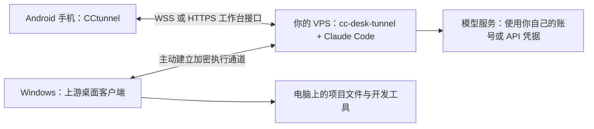
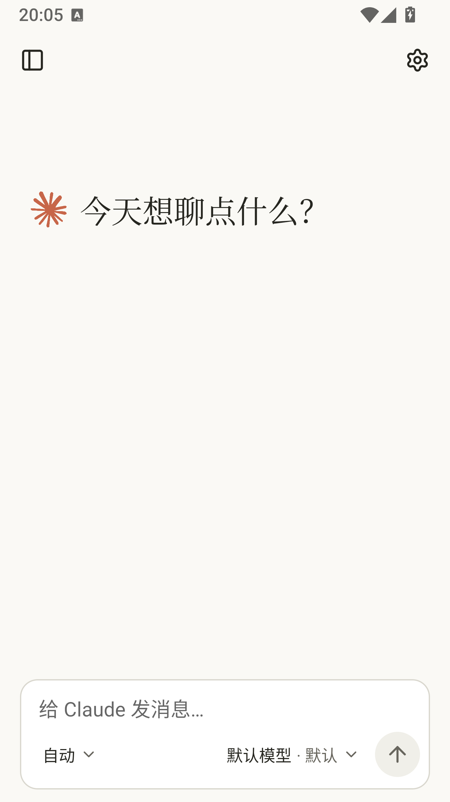
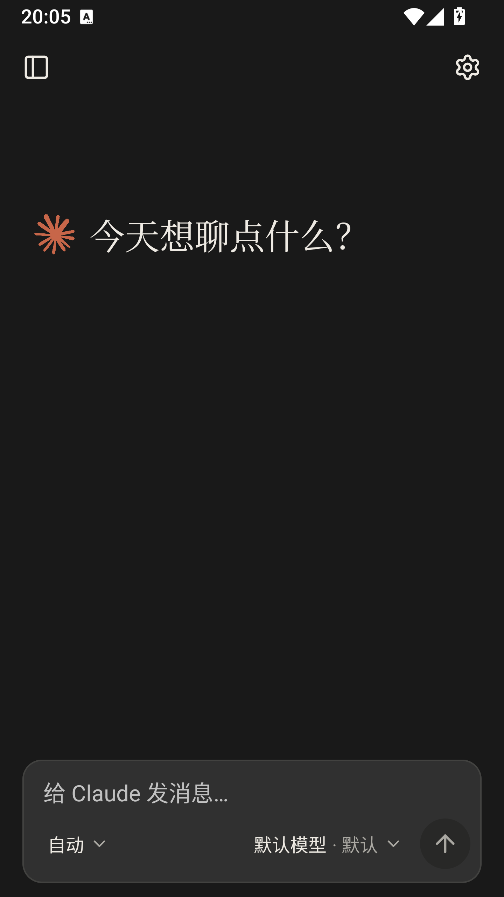
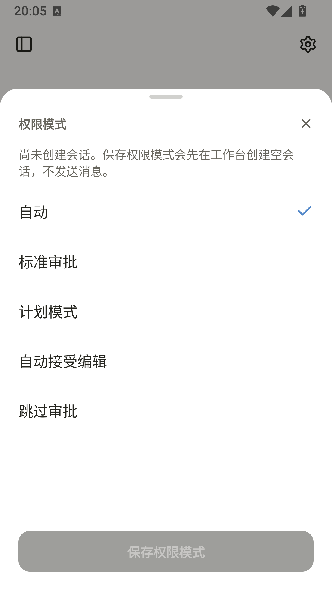
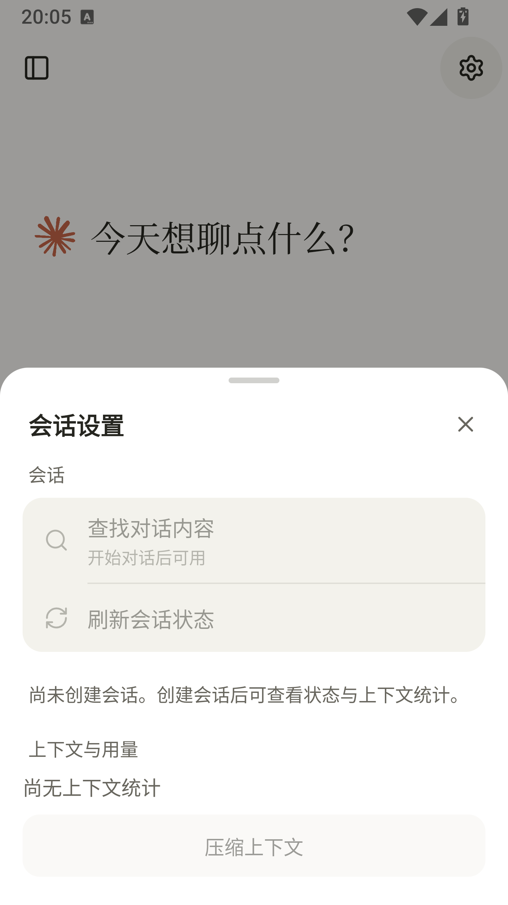

<!-- 默认中文项目说明，英文版本见 README.en.md。 -->

**简体中文** | [English](./README.en.md)

<p align="center">
  
</p>

<div align="center">

# CC Android Tunnel

<p>
  <strong>在 Android 上原生连接你的 CC 工作台</strong><br />
  连接工作台，查看对话与工具执行，管理会话和模型设置。<br />
  <sub>Kotlin · Jetpack Compose · 工作台协议 25</sub>
</p>

<p>
  <a href="https://github.com/tuolola/cc-android-tunnel/releases/download/v1.0.1-native/CCtunnel.apk"></a>
  <a href="#快速开始"></a>
  <a href="#验证与验收"></a>
  <a href="https://github.com/sun168567/cc-desk-tunnel"></a>
  <a href="./LICENSE"></a>
</p>

<p>
  
  
  
  
  
  
</p>

> 使用 Kotlin 与 Jetpack Compose，在 Android 上连接和操作你的工作台。

</div>

先感谢一下原作者 [sun168567](https://github.com/sun168567) 和 [cc-desk-tunnel](https://github.com/sun168567/cc-desk-tunnel) 的贡献者们，把这么实用的项目做出来，还愿意开源分享。有了上游的基础，才有了这个安卓版；这里做的事情，就是让大家离开电脑后，也能拿起手机接着用。原项目的功劳不能少，觉得好用的话，也欢迎去上游点个 Star，支持一下原作者！

## 项目简介

手机桌面与 App 内显示名称为 **CCtunnel**，项目名称为 **CC Android Tunnel**。

**这款 App 用来在 Android 手机上操作你自己的 CC Desk Tunnel 工作台。** 例如，电脑已经打开一个项目，你离开电脑后，可以用手机接着发需求、查看代码修改和工具输出、回复审批、停止任务或继续会话。手机也可以新建在服务器上执行的普通会话。

**CC Android Tunnel 是基于 [sun168567/cc-desk-tunnel](https://github.com/sun168567/cc-desk-tunnel) 独立维护的非官方 Android 原生移植。** 它不是上游官方发布的 Android 版本，也不表示获得了上游背书。

### 它与 cc-desk-tunnel 怎样配合

| 组成 | 安装在哪里 | 负责什么 |
| --- | --- | --- |
| 上游 **cc-desk-tunnel 服务端** | 你自己的 Linux VPS | 运行 Claude Code、保存会话和模型账号配置，连接电脑与手机 |
| 上游 **CC Desk Tunnel 桌面客户端** | 存放项目的 Windows 电脑 | 选择本机项目，建立执行通道，让服务器上的 Claude Code 在这台电脑读写文件、运行命令 |
| 本项目 **CCtunnel Android App** | Android 手机 | 连接同一个服务端，查看和操作会话；不在手机上安装 Claude Code 或运行电脑的开发工具链 |



**会话在哪里运行，取决于会话归属：**

- **操作电脑项目**：先在桌面客户端添加项目并建立会话，再在手机会话列表打开它。电脑必须开机、联网，桌面客户端保持连接，执行通道就绪；手机和电脑不必在同一 Wi-Fi。
- **操作服务器环境**：在手机直接新建的普通会话运行于服务端容器，不会自动使用电脑项目，也不会把手机文件上传进去。需要电脑项目时，应打开已有的电脑会话。

上游提供服务端和电脑执行能力，本仓库提供原生手机操作界面。你仍需准备自己的服务器和可用模型账号/API 凭据；VPS 费用与模型费用分别计算。更多原理见[上游架构说明](https://github.com/sun168567/cc-desk-tunnel/blob/v0.3.14/docs/architecture.md)。

本仓库是独立 Android 工程。界面、网络、Markdown 和代码展示均采用原生实现，不依赖 React Native、Expo、Hermes、Metro、JavaScript 业务运行时，也不使用 WebView 承载界面。构建和运行客户端均不需要 Node.js。

已验证范围、测试运行方式与待验证场景见[验证与验收](#验证与验收)。

使用前需要可访问的**协议 25 工作台服务**及认证信息。本仓库提供 Android 客户端，不包含工作台服务端或模型服务。当前 App 使用中文界面。

## 应用实拍

以下为当前原生 App 在 Android 模拟器上的实拍，展示浅色与深色首页、权限选择和会话设置，不含会话消息或连接凭据。静态截图用于说明界面布局；动画、真实服务流程和不同设备的验证范围见下方[验证与验收](#验证与验收)。

<table>
  <tr>
    <th>浅色首页</th>
    <th>深色首页</th>
  </tr>
  <tr>
    <td><a href="./docs/screenshots/home-light.png"></a></td>
    <td><a href="./docs/screenshots/home-dark.png"></a></td>
  </tr>
  <tr>
    <th>权限选择</th>
    <th>会话设置</th>
  </tr>
  <tr>
    <td><a href="./docs/screenshots/permission-picker.png"></a></td>
    <td><a href="./docs/screenshots/session-settings.png"></a></td>
  </tr>
</table>

## 核心能力

下表描述原生实现范围。具体操作仍受服务端能力和权限限制；功能实现范围与实际验收证据分别列出。

| 范围 | 原生实现 |
| --- | --- |
| 连接与认证 | HTTPS 工作台登录、直接 WSS 服务令牌连接、连接状态、退出与重新连接 |
| 会话与项目 | 会话列表、新建、切换、重命名、删除、置顶；列表中显示项目，支持内容查找及更早历史加载 |
| 对话 | 发送消息、接收流式回复、停止生成、继续执行及请求上下文压缩 |
| 内容展示 | 原生 Markdown、代码语法高亮、表格、链接、图片、文字选择与复制 |
| 工具与交互 | 思考内容、工具调用与结果、权限回复、问题回答、后台任务控制 |
| 模型设置 | 服务端模型列表、自定义模型标识、思考强度及会话配置 |
| 输入区与会话设置 | 输入框左侧选择权限模式，右侧选择模型并发送；右上角齿轮提供内容查找、状态刷新、上下文与后台任务操作 |
| 设置页面 | 连接与访问管理、TOTP 控制、账号与用量、应用内通知和帮助 |
| Android 体验 | 浅色与深色主题、原生多行输入框、键盘避让、滚动、手势、禁用与只读状态 |
| 恢复与本地状态 | 临时断线时保留已加载历史，按持久事件游标恢复；保存服务范围内的偏好，通过 Android Keystore 保护凭据 |

## 快速开始

下面以 **Ubuntu 24.04 LTS x86_64 VPS + Windows 10/11 x64 电脑 + Android 7.0 及以上手机** 为例，从购买服务器到手机接着操作电脑项目。已有服务端和已连接的桌面客户端，可直接从[第 6 步](#第-6-步在手机上安装-cctunnel)开始。

**版本基准（2026-11-14 核对）：** 本教程使用上游 [v0.3.14](https://github.com/sun168567/cc-desk-tunnel/releases/tag/v0.3.14)，其工作台协议为 **25**，与当前 App 对应。上游桌面端和服务端使用同一版本；本项目的 `1.0.x-native` 是独立版本号，不需要与 `0.3.14` 数字相同。以后升级上游时，先确认协议兼容，不要直接假定所有最新版都适用。

### 第 1 步：准备 VPS、电脑和模型账号

**操作位置：电脑浏览器。** VPS 是你租用的一台持续在线的 Linux 服务器。以下是可自行比较、购买的官网入口，没有推广参数：

| 服务商 | 官网 | 选择的产品 |
| --- | --- | --- |
| RackNerd | [racknerd.com](https://www.racknerd.com/) | Linux KVM VPS |
| Vultr | [vultr.com](https://www.vultr.com/) | Cloud Compute；[官方创建教程](https://docs.vultr.com/products/compute/instances/cloud-compute/provisioning) |
| DigitalOcean | [digitalocean.com](https://www.digitalocean.com/products/droplets) | Linux Droplet |
| Hetzner | [hetzner.com](https://www.hetzner.com/cloud/) | Cloud Server |

注册并登录所选服务商，进入 VPS/云服务器创建页面，按下面选择后再付款。套餐库存、续费价、流量、IPv4、备份费用与退款规则以该官网结账页为准；这里不承诺某个商家的价格或线路质量。

| 项目 | 本教程的选择 |
| --- | --- |
| 系统/架构 | Ubuntu 24.04 LTS、x86_64/amd64；不要选 Windows VPS 或只有网站空间的虚拟主机 |
| 资源 | 建议从 **2 vCPU、2 GB 内存、25 GB SSD** 起步，给 Docker、日志与更新留余量；这是本教程建议，不是上游最低要求。主要编译在电脑执行时无需 GPU；若让服务器编译大型项目，要另加资源 |
| 网络 | 可从电脑和手机访问的公网 IPv4，能访问 GitHub、GHCR 和所用模型服务；域名在本教程的直连方式中可不购买 |
| 地区 | 同时确认使用者和服务器满足模型提供方的[支持地区政策](https://www.anthropic.com/legal/supported-regions)及[使用条款](https://code.claude.com/docs/en/legal-and-compliance)；只买一台海外 VPS 不等于获得使用资格 |
| 登录 | 保存公网 IP、SSH 端口、管理员用户名及 SSH 密钥/初始密码。优先使用你自己管理的 SSH 密钥 |

另准备一台存放项目的 Windows 电脑、Android 手机，以及你自己的可用模型账号或 API 凭据。购买 VPS 不会附送 Claude 账号或模型额度。

**完成标志：** 服务商控制台显示服务器运行中，你已经拿到公网 IP 和 SSH 登录方式。

### 第 2 步：登录 VPS，准备 Docker

**操作位置：先在 Windows PowerShell 连接，连接后所有 Linux 命令都在 VPS 上执行。**

```powershell
ssh root@你的服务器公网IP
```

`root` 要换成服务商实际提供的用户名，例如 `ubuntu`；SSH 不是 22 端口时使用 `ssh -p 实际端口 用户名@公网IP`。首次连接核对 SSH 主机指纹，使用服务商提供的密钥或密码登录。这个 SSH 登录与后面 App 的服务凭据是两回事。

在 VPS 执行：

```bash
cat /etc/os-release
uname -m
sudo apt update
sudo apt install -y ca-certificates curl
```

确认系统为 Ubuntu、架构为 `x86_64`。如果尚未安装 Docker，打开 [Docker 官方 Ubuntu 安装页](https://docs.docker.com/engine/install/ubuntu/#install-using-the-apt-repository)，依次完成该页的 **配置 apt 仓库 → 安装 Docker Engine 与 Compose 插件 → 验证安装**，命令也在当前 VPS 终端执行。已有 Docker 的服务器先检查版本，不必重复安装或卸载其他服务依赖。

```bash
sudo docker version
sudo docker compose version
sudo docker run --rm hello-world
```

**完成标志：** Docker 命令能输出服务端版本，Compose 能输出版本，`hello-world` 正常结束。上游安装脚本只检查这些依赖，不会自动替你装好 Docker。

### 第 3 步：在 VPS 部署 cc-desk-tunnel 服务端

**操作位置：VPS SSH 终端。** 对照[上游部署手册](https://github.com/sun168567/cc-desk-tunnel/blob/v0.3.14/deploy/README.md)，下载固定版本的官方安装脚本，再执行：

```bash
curl -fL https://raw.githubusercontent.com/sun168567/cc-desk-tunnel/v0.3.14/deploy/install.sh -o cc-desk-install.sh
less cc-desk-install.sh
sudo env CC_DESK_TUNNEL_VERSION=0.3.14 bash cc-desk-install.sh
```

`less` 用来查看脚本，按 `q` 退出后执行下一条。上面的命令适用于新部署；已有服务不要为套用教程降级，应先核对版本与备份。

安装向导按下面填写，具体选项名称以脚本为准：

| 安装项 | 本教程填写方式 |
| --- | --- |
| 公网地址 | 该 VPS 的公网 IP，确认自动检测结果正确 |
| TLS 入口方式 | 选 **自签证书**，适合先用 IP 跑通；已有域名及可信证书可按上游手册选 CA/nginx 模式 |
| 服务端口 | 默认 `8787` |
| 数据目录 | 默认 `/srv/cc-desk-tunnel`；记录实际选择，账号、历史和配置在这里 |
| 服务凭据 | 留空，由脚本生成随机凭据；不要自行改成短密码 |

程序一般安装到 `/opt/cc-desk-tunnel`。等镜像下载、服务启动完成后，向导会输出三项信息：

| 需要保存的信息 | 示例或含义 | 后面用在哪里 |
| --- | --- | --- |
| 服务地址 | `wss://203.0.113.10:8787/ws`，示例 IP 必须换成自己的 | 桌面端及手机 WSS 直连 |
| SHA-256 证书指纹 | 64 位十六进制，可带冒号；从你自己的 SSH 终端复制 | 自签 TLS 的身份校验 |
| 服务凭据 | 安装器生成的完整随机字符串 | 桌面与手机登录自己的工作台 |

随后在云厂商安全组/防火墙放行 **8787/TCP**，并检查 VPS 自身防火墙；保留你当前用于管理服务器的 SSH 端口。只开放所需端口，不需要开放旧版的 7000，也不需要给 Windows 开入站端口。Docker 发布的端口可能绕过 UFW，来源限制应按[上游安全边界说明](https://github.com/sun168567/cc-desk-tunnel/blob/v0.3.14/docs/deployment.md)配置。nginx 模式改为公网 443，后端 8787 只在本机使用。

```bash
sudo cc-desk-tunnel status
sudo cc-desk-tunnel summary
```

`summary` 可重新查看连接信息，输出包含秘密，不要贴到 README、Issue 或公开截图。服务凭据可以控制这个工作台，连接电脑期间还可触发电脑上的操作。

**完成标志：** `status` 显示服务正常运行，已保存地址、指纹、凭据三项，公网服务端口已放行。

### 第 4 步：在 Windows 安装并连接上游桌面客户端

**操作位置：存放项目的 Windows 电脑。**

1. 打开[上游 v0.3.14 发布页](https://github.com/sun168567/cc-desk-tunnel/releases/tag/v0.3.14)，下载 `CC-Desk-Tunnel-Setup-0.3.14-x64.exe` 和 `SHA256SUMS`。这是电脑安装包，不是手机 APK。
2. 用 PowerShell 的 `Get-FileHash .\CC-Desk-Tunnel-Setup-0.3.14-x64.exe -Algorithm SHA256` 与该发布页校验清单核对后安装。安装包自带所需的 PowerShell 7/OpenSSH；安装说明见[上游图形客户端](https://github.com/sun168567/cc-desk-tunnel/tree/v0.3.14#图形客户端)。
3. 启动桌面客户端，填写第 3 步的 **WSS 服务地址、证书指纹、服务凭据**，点击连接。自签证书必须填写已核实的指纹；可信 CA 域名证书通常将指纹留空。
4. 等待工作台连接成功、电脑执行通道就绪，再进行下一步。

**完成标志：** 电脑已进入工作台，没有“执行通道尚未就绪”的提示。Windows 主动连接 VPS，不需要路由器端口映射。

### 第 5 步：配置模型访问，创建一个电脑项目会话

**操作位置：上游桌面客户端；若选 API 配置，另在 VPS 操作。**

模型认证方式在下面第 1、2 项中选择适合自己的一种，然后从第 3 项继续创建项目。

1. 按[上游账号登录说明](https://github.com/sun168567/cc-desk-tunnel/tree/v0.3.14#3-登录-claude)，在桌面客户端的账号页完成你自己的官方 Claude 登录。只有账号本身具有可用权限/额度且使用方式符合提供方条款，模型请求才会成功；登录凭据保存在服务端。
2. 如果采用 API 方式，按[上游“模型与可写空间”](https://github.com/sun168567/cc-desk-tunnel/blob/v0.3.14/deploy/README.md#模型与可写空间)在 VPS 的 `<实际数据目录>/config/provider.json` 配置提供方支持的环境变量。默认路径为 `/srv/cc-desk-tunnel/config/provider.json`；保留 JSON 结构，不把 API Key 填进手机“服务凭据”栏。配置完成后在 VPS 执行 `sudo cc-desk-tunnel restart`，再回桌面客户端检查账号/模型状态。
3. 回到桌面客户端，添加一个本机项目文件夹，例如 `D:\Projects\hello-tunnel`，在这个项目中创建会话，命名为“手机联调”。
4. 先发一条只读验证消息：`请列出当前项目根目录的文件，并告诉我命令执行在哪个目录，不要修改任何文件。`
5. 核对返回路径属于这台 Windows 电脑，并能看到该目录的真实文件。出现工具审批时先阅读请求，再决定是否允许。

三种秘密不要混用：**VPS SSH 密码/密钥**用于管理服务器，**工作台服务凭据**用于连接 cc-desk-tunnel，**模型账号/API Key**用于服务端调用模型。

**完成标志：** 桌面会话有真实回复，工具能读到指定的电脑项目。先让这条链路跑通，再连接手机。

### 第 6 步：在手机上安装 CCtunnel

**操作位置：Android 手机；需要自行构建时在开发电脑操作。**

1. [直接下载 CCtunnel.apk（v1.0.1-native）](https://github.com/tuolola/cc-android-tunnel/releases/download/v1.0.1-native/CCtunnel.apk)。适用于 **Android 7.0 及以上**，当前为 **Debug 签名的公开测试版**。查看[版本发布说明](https://github.com/tuolola/cc-android-tunnel/releases/tag/v1.0.1-native)和 [SHA256SUMS.txt 校验清单](https://github.com/tuolola/cc-android-tunnel/releases/download/v1.0.1-native/SHA256SUMS.txt)。
2. 核对 SHA-256 后将 APK 传到手机安装。也可以连接 USB 调试，在 APK 所在目录执行 `adb install -r .\CCtunnel.apk`。已有应用须同包名、同签名且版本允许更新，才能覆盖安装。
3. 打开手机上的 **CCtunnel**。手机只需安装 APK；Node、Docker、Android Studio 均不需要安装到手机。

需要自行构建时，见[从源码构建 Android App](#从源码构建-android-app)。上游发布页的 Windows/macOS/Linux 包用于电脑，不能安装到手机。

**完成标志：** 手机可以打开 App 的“连接工作台”页面。

### 第 7 步：手机连接同一个服务端

**操作位置：手机 CCtunnel。主流程使用 WSS 直连，不要求开启上游 Web 访问。**

1. 打开“连接工作台”。如当前显示 HTTPS 登录方式，切换到“使用服务地址直连”。
2. 按下表填入第 3 步保存的三项信息，然后点“连接”。

| 手机字段 | 应填内容 | 不要填写 |
| --- | --- | --- |
| 服务地址 | 完整的 `wss://你的公网IP:8787/ws`；nginx/可信域名入口可能是 `wss://你的域名/ws` | 手机的 `localhost`、Windows 局域网 IP、SSH 地址或省略 `/ws` 的地址 |
| 服务证书指纹（可选） | 自签证书填写经 SSH 核对的 SHA-256 指纹；系统信任的 CA 证书留空 | SSH 主机指纹、随意猜测的指纹；不要通过关闭校验来连接 |
| 服务凭据 | 安装器生成的完整工作台凭据 | VPS 密码、Claude 登录密码或模型 API Key |

3. 连接成功后打开会话列表，选择刚才的“手机联调”会话，确认能看到电脑上的历史。
4. 如果只想继续操作电脑项目，直接进入这个已有会话。**不要为了找电脑项目而点新建：手机直接新建的是服务端会话。**

WSS 直连使用服务凭据认证；HTTPS 模式才使用 Web 登录、Cookie 与可选 TOTP。开启 Web TOTP 不会让 WSS 直连自动要求动态码，两种入口的凭据管理要分别理解。

**完成标志：** 手机显示已连接，能打开同一条电脑会话及其历史。

### 第 8 步：完成一次“电脑开始，手机继续”的使用流程

1. **电脑**：保持上游桌面客户端连接，保留“手机联调”会话，确保测试项目没有未备份的重要改动。离开时可以让客户端在托盘运行，但电脑不要睡眠、关机或断网。
2. **手机**：进入同一会话，发送：`请在当前测试项目中新建 mobile-check.txt，写入 Hello from Android。若文件已存在，先告诉我，不要覆盖。`
3. **手机**：观察流式回复与工具调用；如果服务端发出审批请求，核对文件和操作后再选择。当前手机没有对所有真实审批场景完成验收，遇到无法处理的请求应回桌面处理。
4. **电脑**：检查测试项目中是否生成了文件、内容是否正确。成功说明手机控制消息经 VPS 到达了电脑执行通道。
5. **手机**：下次打开同一会话即可接着做。需要停止时点停止；会话可继续执行时再使用继续。手机断网后先恢复连接，核对已有结果，避免重复发送会修改文件的请求。

日常使用只需保持 **VPS 运行 + 项目电脑在线且桌面端连接 + 手机可访问 VPS**。如果工作仅在手机新建的服务端会话中进行，执行环境是服务器容器，不要求该 Windows 电脑在线，但服务器需要具备那个任务的文件和工具。

### 可选：改用 HTTPS 工作台入口登录手机

WSS 已能满足上述流程。需要 Web 登录/TOTP 时，按[上游浏览器访问说明](https://github.com/sun168567/cc-desk-tunnel/blob/v0.3.14/docs/server-web.md)另行启用：

1. **电脑桌面客户端**打开“设置 → 浏览器访问”，启用 Web 访问，复制它显示的完整 HTTPS 地址。自定义域名和路径也必须保留。
2. **手机 App**在“连接工作台”切换到“浏览器访问”，将该地址填入“HTTPS 入口地址”；不要填 `/ws`，也不要手工拼接 `/api/ws`。
3. 可信 CA 证书将指纹留空；自签入口填写该入口的可信 SHA-256 证书指纹。然后连接，在“工作台密码”填工作台服务凭据；启用了验证器时，再输入当前六位动态码登录。
4. 域名/路径变更或登录过期后，使用新入口重新登录。需要域名与反向代理时，继续参考[上游 nginx 配置](https://github.com/sun168567/cc-desk-tunnel/blob/v0.3.14/deploy/nginx.md)。

这里“浏览器访问”是上游认证接口的名称；App 仍使用 Kotlin/Compose 原生界面，不会打开 WebView 来承载聊天。

### 常见问题与日常维护

| 现象 | 按顺序检查 |
| --- | --- |
| 手机连接超时 | VPS 是否运行 → 公网 IP/端口是否正确 → 云安全组和主机防火墙 → 手机网络是否能到达 VPS；不要用 Windows 内网地址代替 VPS |
| 证书错误 | 指纹是否完整且对应实际入口、证书是否续期/替换、手机时间和证书有效期；从自己的 SSH 终端重新核对，不关闭 TLS 校验 |
| 服务凭据错误 | 是否误填 SSH 密码或模型 Key；复制完整随机凭据。凭据轮换后桌面和手机都要更新 |
| HTTPS 入口返回 404/没有登录信息 | 桌面端 Web 访问是否开启，域名和自定义路径是否一致；WSS 方式则应使用根路径 `/ws` |
| 手机能看历史，但电脑项目不能执行 | 电脑是否在线、未睡眠，上游桌面端和执行通道是否保持连接，会话是否属于那台电脑 |
| 手机新会话里找不到 `D:\Projects` | 新建的是 Linux 服务端会话；回到电脑先建立项目会话，再从手机打开 |
| 已连接但模型不回复 | 在桌面账号页检查授权、额度及模型配置，并检查服务器到模型服务的网络；工作台连接成功不代表模型账号可用 |
| 提示协议/版本不一致 | 本 App 使用协议 25；先核对上游版本及兼容性，不要盲目升级或降级 |

在 VPS 上可运行以下命令；详细操作见[上游运维手册](https://github.com/sun168567/cc-desk-tunnel/blob/v0.3.14/deploy/README.md#运维)：

```bash
sudo cc-desk-tunnel status
sudo cc-desk-tunnel logs
sudo cc-desk-tunnel summary
```

升级或改证书前先结束任务、备份数据，再按上游手册操作。备份包含凭据和会话内容，应私有保存。Android App 独立更新，不能把上游桌面端的“一键升级”理解成手机 APK 会同步更新。

## 从源码构建 Android App

这部分在开发电脑执行，用于检查、修改或自行构建 Android App。它不是 VPS 服务端安装步骤。

### 1. 准备环境

- JDK **17 或 21**，配置 `JAVA_HOME`。
- Android SDK **platform 36**、Android SDK Build Tools，以及安装应用所需的 Platform Tools。
- Android **7.0 / API 24** 及以上的设备或模拟器。
- 首次构建需要联网下载 Gradle 和依赖；仓库已包含 **Gradle 8.13** wrapper。

```bash
git clone --branch native/android-compose https://github.com/tuolola/cc-android-tunnel.git
cd cc-android-tunnel
```

用兼容 Android Gradle Plugin 8.13.1 的 Android Studio 打开仓库根目录，或直接使用命令行构建。

### 2. 构建与安装

Windows 下将 `ANDROID_HOME` 指向 SDK 目录，然后执行：

```powershell
.\scripts\build-native.ps1
adb install -r .\artifacts\CCtunnel.apk
```

脚本会构建调试 APK、运行 JVM 测试和 Android Lint，将 APK 复制到 **`artifacts/CCtunnel.apk`**，并输出 SHA-256。可传入 `-AndroidSdk <路径>` 和 `-GradleCache <路径>`；`-SkipTests` 会跳过 JVM 测试和 Lint。

也可以在不纳入版本控制的 `local.properties` 中配置 `sdk.dir`，直接调用 Gradle：

```powershell
.\gradlew.bat :app:assembleDebug :app:testDebugUnitTest :app:lintDebug
```

macOS/Linux 使用 `./gradlew`。直接构建的 APK 位于 **`app/build/outputs/apk/debug/app-debug.apk`**。`:app:assembleRelease` 生成未签名的 Release APK，分发前需要自行配置签名。

安装完成后返回[手机连接步骤](#第-7-步手机连接同一个服务端)。应用不内置服务地址、密码或令牌。

## 验证与验收

### 运行检查

```powershell
.\gradlew.bat :app:testDebugUnitTest :app:lintDebug
.\gradlew.bat :app:connectedDebugAndroidTest
python -B -m unittest discover -s scripts -p "test_*.py"
python -B scripts/audit-native-apk.py app/build/outputs/apk/debug/app-debug.apk --project . --dependencies app/build/reports/native-boundary/native-dependencies.txt
```

设备测试需要连接模拟器或设备，独立 APK 审计需要先完成上方的 APK 构建。Python 仅用于可选的独立 APK 审计及其回归测试，App 和 Gradle 构建不依赖 Python。

启动与动画流畅度可按[性能与流畅度测试](./docs/performance-testing.md)使用 `scripts/measure-performance.ps1` 采样。该工具记录启动耗时或指定操作窗口内的 Android 帧统计，输出保存到已忽略的 `artifacts/performance/`；诊断采样不等同于发布版本性能验收。

[原生构建检查](./gradle/native-boundary.gradle.kts) 会检查生产源码及已解析的运行时依赖；APK 构建还会检查 DEX 引用、打包资源和原生库，拒绝受限的 JavaScript 引擎及 WebView 渲染。[Python 审计](./scripts/audit-native-apk.py) 提供独立复核。检查允许 AndroidX 的静态 `WebView.findAddress` 兼容引用，仍会拒绝创建或渲染 WebView。

### 当前验证结果 — 2026-11-14

| 检查 | 本轮结果 |
| --- | --- |
| 构建 | Debug APK 与 Android 设备测试 APK 构建成功 |
| JVM 测试 | 43 项通过，0 项失败 |
| 独立审计回归测试 | 8 项通过 |
| Android Lint | 0 个错误，37 条警告 |
| 原生约束 | APK 原生边界检查与独立 APK 审计通过 |
| 完整 Android 设备套件 | 共 61 项：58 项通过、3 项真实服务 opt-in 测试跳过、0 项失败 |

设备套件包含 13 项会话设置测试，涵盖权限模式保存与取消、草稿会话创建、只读和运行中状态、窄屏输入区，以及重复停止请求的处理。本轮未重新运行完整真实服务流程；3 项 opt-in 跳过不计作真实连接、工具执行或断网恢复验收通过。以上为本轮构建和指定模拟器上的结果，不代表所有设备均已验证。

### 测试源码与验收边界

| 测试 | 用途 |
| --- | --- |
| [协议](./app/src/test/java/dev/ccdesk/nativeapp/core/ProtocolTest.kt) · [安全](./app/src/test/java/dev/ccdesk/nativeapp/core/SecurityTest.kt) | 流式片段合并、历史游标、继续执行、重连隔离、认证和 TLS 规则 |
| [原生 TLS 集成](./app/src/androidTest/java/dev/ccdesk/nativeapp/core/NativeTlsIntegrationTest.kt) · [凭据存储](./app/src/androidTest/java/dev/ccdesk/nativeapp/core/CredentialVaultTest.kt) · [静默连接恢复](./app/src/androidTest/java/dev/ccdesk/nativeapp/core/SilentPeerRecoveryTest.kt) | Android 上的本地 TLS fixture、加密凭据和无 Pong 响应时的连接恢复 |
| [UI 设备测试](./app/src/androidTest/java/dev/ccdesk/nativeapp/ui) | 原生输入框、Markdown、审批/问题 fixture、模型、设置、手势与全部七份离线许可全文 |
| [会话设置](./app/src/androidTest/java/dev/ccdesk/nativeapp/ui/SessionSettingsTest.kt) | 权限模式、保存与取消、会话操作、状态限制和窄屏输入区 |
| [真实聊天](./app/src/androidTest/java/dev/ccdesk/nativeapp/core/LiveWorkbenchAcceptanceTest.kt) · [真实工具](./app/src/androidTest/java/dev/ccdesk/nativeapp/core/RealToolAcceptanceTest.kt) · [真实网络](./app/src/androidTest/java/dev/ccdesk/nativeapp/core/RealNetworkRecoveryTest.kt) | 显式 opt-in 测试，需要真实服务或网络中断条件；默认跳过不计作验收通过 |

启用 opt-in 测试前请阅读对应参数检查。真实服务测试要求显式匹配目标主机且已登录；网络测试会临时关闭 Wi-Fi，并要求指定测试会话。应在测试设备和服务上运行。

**仍未完成的验收：**

- 真实权限审批和问题回答往返链路；当前审批/问题覆盖来自原生 UI fixture。
- 真实后台任务、完整 TOTP/访问撤销流程，以及覆盖多个完整窗口的历史分页。
- 实际设备上的动画流畅度、快速连续操作及中断后的视觉表现；受控时钟下的手势测试不能替代这些检查。
- 实体设备触觉反馈、TalkBack、更多 Android API 级别及大字体缩放。
- 不同系统字体、文字选择手柄和屏幕尺寸下的完整视觉检查。

## 安全与本地数据

连接必须使用 HTTPS/WSS。系统 CA 模式保留平台信任链和主机名校验；显式指纹模式检查配置主机、完整叶证书指纹和证书有效期，不存在信任所有证书的降级方式。认证请求禁止重定向。

保存的令牌和浏览器会话 Cookie 使用 Android Keystore 加密。退出和更改信任配置会清除相应凭据，应用备份已禁用。服务范围内的本地偏好与凭据分开存储；断线时保留的历史不是全部服务端会话的离线存档。

Android 安装标识为 `dev.ccdesk.nativeapp`，连接深链使用 `cc-android-tunnel://`。

## 项目结构

| 路径 | 职责 |
| --- | --- |
| `app/src/main/java/dev/ccdesk/nativeapp/core` | 协议、协程状态、网络传输、证书信任与加密凭据 |
| `app/src/main/java/dev/ccdesk/nativeapp/ui` | Compose 页面、原生输入框、消息投影、Markdown、图标与手势 |
| `app/src/main/res` | 应用资源、原有图标和第三方许可声明 |
| `app/src/test` | JVM 协议、安全、消息投影和代码高亮测试 |
| `app/src/androidTest` | Android 集成、UI 及 opt-in 真实服务验收测试 |
| `gradle/native-boundary.gradle.kts` | 源码、依赖和 APK 的原生约束检查 |
| `scripts` | Windows 构建、独立 APK 审计及性能诊断脚本 |

## 来源与许可

本项目基于 **[sun168567/cc-desk-tunnel](https://github.com/sun168567/cc-desk-tunnel)**，由 **[tuolola/cc-android-tunnel](https://github.com/tuolola/cc-android-tunnel)** 独立维护，是非官方 Android 原生移植。项目保留上游贡献与来源声明，并独立维护原生实现。

项目代码和文档使用 **[Apache License 2.0](./LICENSE)**。来源与归属说明见 **[NOTICE](./NOTICE)**。第三方依赖、图标及改编代码保留各自许可，包括[随应用打包的第三方许可汇总](./app/src/main/res/raw/third_party_notices.txt)和 [app/src/main/res/raw](./app/src/main/res/raw) 中的单独声明；重新分发源码或应用时请一并保留。

项目许可、来源归属及第三方声明也可在 App 的 **帮助 → 开源许可与致谢** 中离线阅读。
