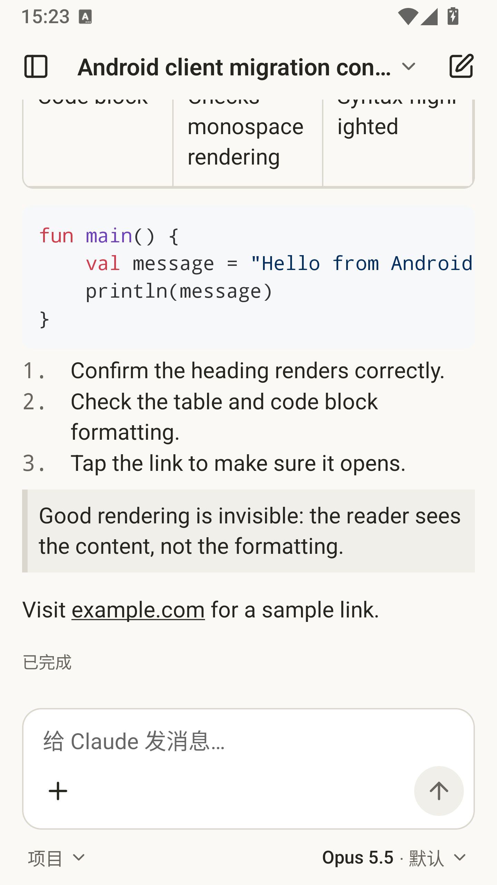
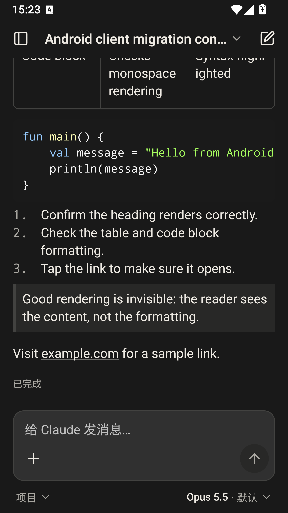
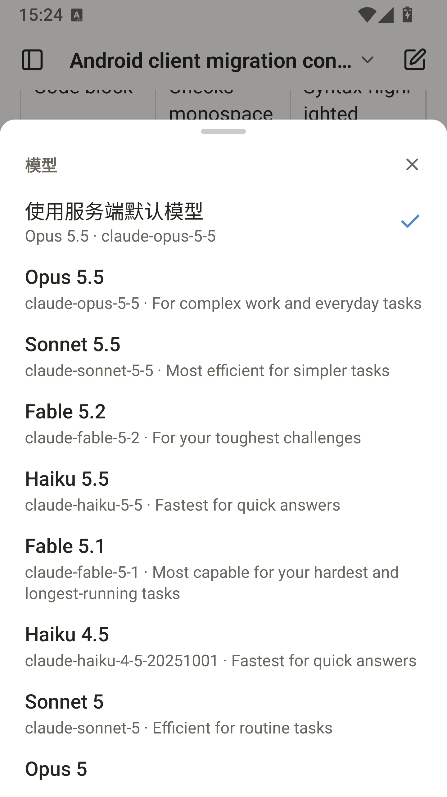
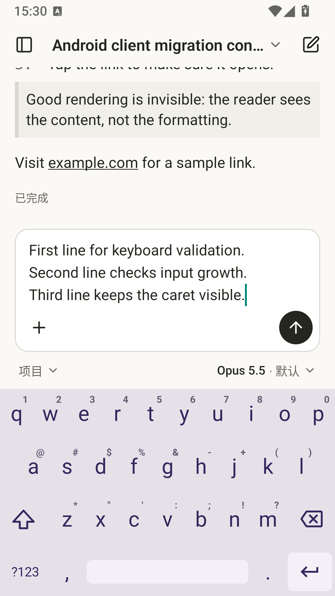

<!-- 默认中文项目说明，英文版本见 README.en.md。 -->

**简体中文** | [English](./README.en.md)

<p align="center">
  
</p>

<div align="center">

# CC Android Tunnel

<p>
  <strong>在 Android 上原生连接你的 CC 工作台</strong><br />
  连接工作台，查看对话与工具执行，管理会话和模型设置。<br />
  <sub>Kotlin · Jetpack Compose · 工作台协议 25</sub>
</p>

<p>
  <a href="#快速开始"></a>
  <a href="#验证与验收"></a>
  <a href="https://github.com/sun168567/cc-desk-tunnel"></a>
  <a href="./LICENSE"></a>
</p>

<p>
  
  
  
  
  
  
</p>

> 以现有 Android 界面和工作台协议为基准，独立构建原生客户端。

</div>

## 项目简介

**CC Android Tunnel 是基于 [sun168567/cc-desk-tunnel](https://github.com/sun168567/cc-desk-tunnel) 独立维护的非官方 Android 原生移植。** 它不是上游官方发布的 Android 版本，也不表示获得了上游背书。

本仓库是独立 Android 工程。界面、网络、Markdown 和代码展示均采用原生实现，不依赖 React Native、Expo、Hermes、Metro、JavaScript 业务运行时，也不使用 WebView 承载界面。构建和运行客户端均不需要 Node.js。

迁移遵循现有 Android App 的布局与交互，但**不宣称已经完全像素一致，也不宣称所有功能均已完成验收**。已验证范围和待办见[验证与验收](#验证与验收)。

使用前需要可访问的**协议 25 工作台服务**及认证信息。本仓库提供 Android 客户端，不包含工作台服务端或模型服务。当前 App 保留 Android 基线中的中文界面文案。

## 应用实拍

以下截图来自 **2026-11-14 的原生调试版本**，在 Android 14 模拟器上直接截取（1440 × 2560、640 dpi、字体缩放 1.0），保留原始 PNG。截图拍摄于项目更名前，展示专用英文验收会话；模型列表由测试服务提供，多行输入使用测试键盘。构建指纹和图片校验值见[截图记录](./docs/screenshots/capture-info.json)。

<table>
  <tr>
    <th>浅色聊天与代码展示</th>
    <th>深色聊天</th>
  </tr>
  <tr>
    <td><a href="./docs/screenshots/chat-light.png"></a></td>
    <td><a href="./docs/screenshots/chat-dark.png"></a></td>
  </tr>
  <tr>
    <th>模型选择</th>
    <th>多行输入与键盘</th>
  </tr>
  <tr>
    <td><a href="./docs/screenshots/model-picker.png"></a></td>
    <td><a href="./docs/screenshots/multiline-input.png"></a></td>
  </tr>
</table>

## 核心能力

下表描述原生实现范围。具体操作仍受服务端能力和权限限制；功能实现范围与实际验收证据分别列出。

| 范围 | 原生实现 |
| --- | --- |
| 连接与认证 | HTTPS 工作台登录、直接 WSS 服务令牌连接、连接状态、退出与重新连接 |
| 会话与项目 | 会话列表、新建、切换、重命名、删除、置顶；项目显示、内容查找及更早历史加载 |
| 对话 | 发送消息、接收流式回复、停止生成、继续执行及请求上下文压缩 |
| 内容展示 | 原生 Markdown、代码语法高亮、表格、链接、图片、文字选择与复制 |
| 工具与交互 | 思考内容、工具调用与结果、权限回复、问题回答、后台任务控制 |
| 模型设置 | 服务端模型列表、自定义模型标识、思考强度及会话配置 |
| 设置页面 | 连接与访问管理、TOTP 控制、账号与用量、应用内通知和帮助 |
| Android 体验 | 浅色与深色主题、原生多行输入框、键盘避让、滚动、手势、禁用与只读状态 |
| 恢复与本地状态 | 临时断线时保留已加载历史，按持久事件游标恢复；保存服务范围内的偏好，通过 Android Keystore 保护凭据 |

## 快速开始

### 1. 准备环境

- JDK **17 或 21**，配置 `JAVA_HOME`。
- Android SDK **platform 36**、Android SDK Build Tools，以及安装应用所需的 Platform Tools。
- Android **7.0 / API 24** 及以上的设备或模拟器。
- 首次构建需要联网下载 Gradle 和依赖；仓库已包含 **Gradle 8.13** wrapper。

```bash
git clone --branch native/android-compose https://github.com/tuolola/cc-android-tunnel.git
cd cc-android-tunnel
```

用兼容 Android Gradle Plugin 8.13.1 的 Android Studio 打开仓库根目录，或直接使用命令行构建。

### 2. 构建与安装

Windows 下将 `ANDROID_HOME` 指向 SDK 目录，然后执行：

```powershell
.\scripts\build-native.ps1
adb install -r .\artifacts\CC-Android-Tunnel-debug.apk
```

脚本会构建调试 APK、运行 JVM 测试和 Android Lint，将 APK 复制到 **`artifacts/CC-Android-Tunnel-debug.apk`**，并输出 SHA-256。可传入 `-AndroidSdk <路径>` 和 `-GradleCache <路径>`；`-SkipTests` 会跳过 JVM 测试和 Lint。

也可以在不纳入版本控制的 `local.properties` 中配置 `sdk.dir`，直接调用 Gradle：

```powershell
.\gradlew.bat :app:assembleDebug :app:testDebugUnitTest :app:lintDebug
```

macOS/Linux 使用 `./gradlew`。直接构建的 APK 位于 **`app/build/outputs/apk/debug/app-debug.apk`**。`:app:assembleRelease` 生成未签名的 Release APK，分发前需要自行配置签名。

### 3. 连接工作台

打开 App 的连接设置，填写 HTTPS 工作台地址或受支持的直接 WSS 服务地址，再提供对应的密码/TOTP 或服务令牌。直接服务地址使用 `/ws` 路径。

可信证书可使用系统 CA 验证；需要指纹方式时，为目标主机配置已核对的服务端 SHA-256 证书指纹。请从服务管理员处获取指纹。应用不内置服务地址、密码或令牌。

## 验证与验收

### 运行检查

```powershell
.\gradlew.bat :app:testDebugUnitTest :app:lintDebug
.\gradlew.bat :app:connectedDebugAndroidTest
python -B -m unittest discover -s scripts -p "test_*.py"
python -B scripts/audit-native-apk.py app/build/outputs/apk/debug/app-debug.apk --project . --dependencies app/build/reports/native-boundary/native-dependencies.txt
```

设备测试需要连接模拟器或设备。Python 仅用于可选的独立 APK 审计及其回归测试，App 和 Gradle 构建不依赖 Python。

[原生构建检查](./gradle/native-boundary.gradle.kts) 会检查生产源码及已解析的运行时依赖；APK 构建还会检查 DEX 引用、打包资源和原生库，拒绝受限的 JavaScript 引擎及 WebView 渲染。[Python 审计](./scripts/audit-native-apk.py) 提供独立复核。检查允许 AndroidX 的静态 `WebView.findAddress` 兼容引用，仍会拒绝创建或渲染 WebView。

### 已记录的迁移验证 — 2026-11-14

| 证据 | 已验证范围 |
| --- | --- |
| 构建与静态检查 | Debug 和未签名 Release 构建完成；36 项 JVM 测试、8 项审计回归测试通过。Lint 无错误，仍有 29 条警告。 |
| 设备测试套件 | 39 项通过、4 项显式 opt-in 测试跳过、0 项失败。跳过不计入验收通过。 |
| 真实服务 | 已操作会话生命周期、模型与思考强度设置、流式回复、停止/继续、一次更早历史请求、重连、上下文压缩与退出。 |
| 真实工具执行 | 受限测试工具实际执行并完成；服务端**没有触发权限审批**。 |
| 真实网络中断 | 独立 Wi-Fi 断网恢复测试通过，51 条持久历史事件保留且没有重复；该结果与普通套件的 opt-in 跳过分开记录。 |
| 视觉对照 | 在同一 Android 14 模拟器、1440 × 2560、640 dpi、字体缩放 1.0 下，对比了 14 组新旧截图，并声明比较区域。文字/图标边缘和文字选择行为仍有差异。 |

以上记录来自项目更名之前的迁移验收，不代表更名后的构建已重新通过验收。这些是指定日期的迁移验证记录，不是 CI 状态，也不代表所有服务和设备都会得到相同结果。私有服务记录及含敏感信息的截图不公开；上方仅展示已检查的应用实拍。

### 测试源码与验收边界

| 测试 | 用途 |
| --- | --- |
| [协议](./app/src/test/java/dev/ccdesk/nativeapp/core/ProtocolTest.kt) · [安全](./app/src/test/java/dev/ccdesk/nativeapp/core/SecurityTest.kt) | 流式片段合并、历史游标、继续执行、重连隔离、认证和 TLS 规则 |
| [原生 TLS 集成](./app/src/androidTest/java/dev/ccdesk/nativeapp/core/NativeTlsIntegrationTest.kt) · [凭据存储](./app/src/androidTest/java/dev/ccdesk/nativeapp/core/CredentialVaultTest.kt) · [静默连接恢复](./app/src/androidTest/java/dev/ccdesk/nativeapp/core/SilentPeerRecoveryTest.kt) | Android 上的本地 TLS fixture、加密凭据和无 Pong 响应时的连接恢复 |
| [UI 设备测试](./app/src/androidTest/java/dev/ccdesk/nativeapp/ui) | 原生输入框、Markdown、审批/问题 fixture、模型、设置、手势与全部七份离线许可全文 |
| [真实聊天](./app/src/androidTest/java/dev/ccdesk/nativeapp/core/LiveWorkbenchAcceptanceTest.kt) · [真实工具](./app/src/androidTest/java/dev/ccdesk/nativeapp/core/RealToolAcceptanceTest.kt) · [真实网络](./app/src/androidTest/java/dev/ccdesk/nativeapp/core/RealNetworkRecoveryTest.kt) · [录制动画](./app/src/androidTest/java/dev/ccdesk/nativeapp/core/RecordedMotionTest.kt) | 4 项显式 opt-in 测试，分别需要真实服务、网络中断条件或指定录像 |

启用 opt-in 测试前请阅读对应参数检查。真实服务测试要求显式匹配目标主机且已登录；网络测试会临时关闭 Wi-Fi，并要求指定测试会话。应在测试设备和服务上运行。

**仍未完成的验收：**

- 真实权限审批和问题回答往返链路；当前审批/问题覆盖来自原生 UI fixture。
- 真实后台任务、完整 TOTP/访问撤销流程，以及覆盖多个完整窗口的历史分页。
- 可靠的新旧动画逐帧对照；受控时钟下的手势测试不能替代录制帧验收。
- 实体设备触觉反馈、TalkBack、更多 Android API 级别及大字体缩放。
- 剩余文字、图标与选择手柄差异；局部截图区域不能证明整个应用像素一致。

## 安全与本地数据

连接必须使用 HTTPS/WSS。系统 CA 模式保留平台信任链和主机名校验；显式指纹模式检查配置主机、完整叶证书指纹和证书有效期，不存在信任所有证书的降级方式。认证请求禁止重定向。

保存的令牌和浏览器会话 Cookie 使用 Android Keystore 加密。退出和更改信任配置会清除相应凭据，应用备份已禁用。服务范围内的本地偏好与凭据分开存储；断线时保留的历史不是全部服务端会话的离线存档。

更名保留 Android 安装标识 `dev.ccdesk.nativeapp`、源码包及加密存储键，以兼容已有安装和凭据。新深链使用 `cc-android-tunnel://`，同时兼容已有的 `ccdesk://` 链接。

## 项目结构

| 路径 | 职责 |
| --- | --- |
| `app/src/main/java/dev/ccdesk/nativeapp/core` | 协议、协程状态、网络传输、证书信任与加密凭据 |
| `app/src/main/java/dev/ccdesk/nativeapp/ui` | Compose 页面、原生输入框、消息投影、Markdown、图标与手势 |
| `app/src/main/res` | 应用资源、原有图标和第三方许可声明 |
| `app/src/test` | JVM 协议、安全、消息投影和代码高亮测试 |
| `app/src/androidTest` | Android 集成、UI 及 opt-in 真实服务验收测试 |
| `gradle/native-boundary.gradle.kts` | 源码、依赖和 APK 的原生约束检查 |
| `scripts` | Windows 构建脚本与独立 APK 审计 |

## 来源与许可

本项目基于 **[sun168567/cc-desk-tunnel](https://github.com/sun168567/cc-desk-tunnel)**，由 **[tuolola/cc-android-tunnel](https://github.com/tuolola/cc-android-tunnel)** 独立维护，是非官方 Android 原生移植。迁移以现有 Android 客户端作为视觉和行为基准，保留上游贡献与来源声明，并独立维护原生实现。

项目代码和文档使用 **[Apache License 2.0](./LICENSE)**。来源与归属说明见 **[NOTICE](./NOTICE)**。第三方依赖、图标及改编代码保留各自许可，包括[随应用打包的第三方许可汇总](./app/src/main/res/raw/third_party_notices.txt)和 [app/src/main/res/raw](./app/src/main/res/raw) 中的单独声明；重新分发源码或应用时请一并保留。

项目许可、来源归属及第三方声明也可在 App 的 **帮助 → 开源许可与致谢** 中离线阅读。
